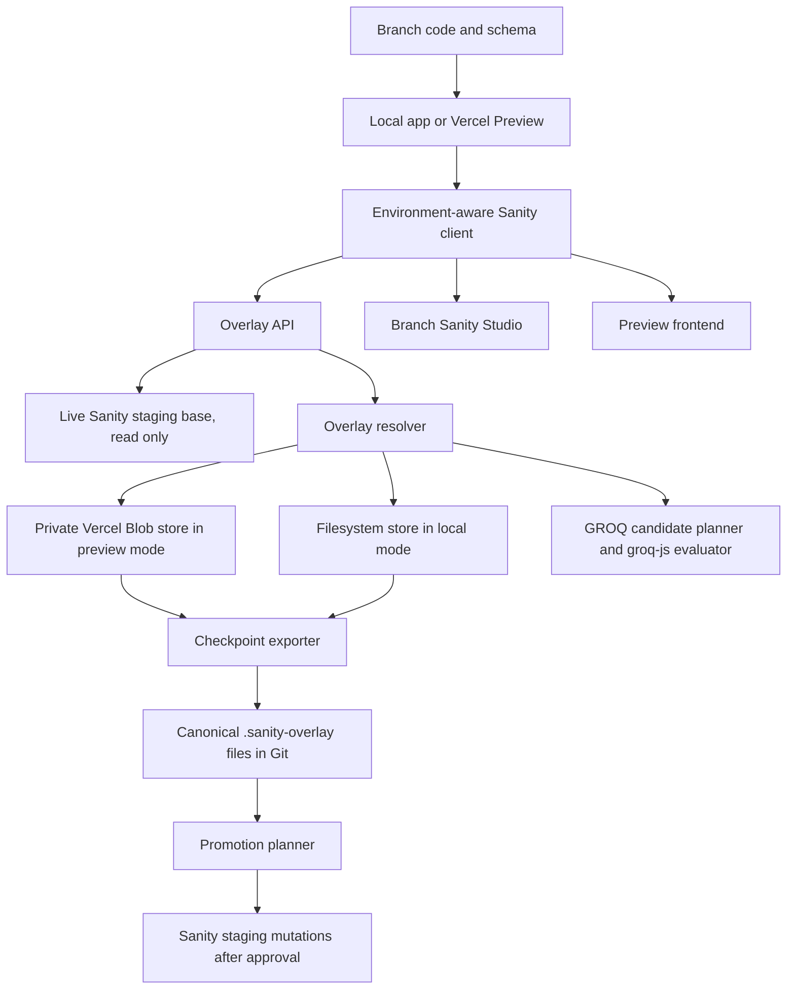
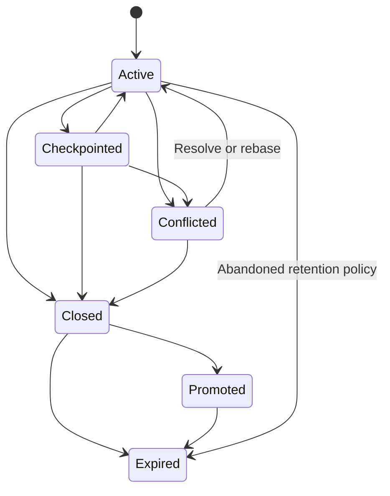

# PRD: Sanity Branch Overlay

**Status:** Revised feasibility specification  
**Date:** 2026-08-03  
**Primary use case:** Branch-local Sanity schema and content editing for local development, coding agents, pull requests, and Vercel Preview Deployments  
**Production stance:** Production and shared staging continue to use Sanity Content Lake directly  
**Source policy:** Product claims and platform constraints are cited with source IDs such as `[S01]`; full links are in [Sources](#40-sources)

---

## 0. Read this first

### 0.1 Product in one sentence

Create a virtual Sanity dataset per branch by combining a live, read-only Sanity staging base with a branch-scoped copy-on-write overlay stored as local JSON files or private Vercel Blob objects.

### 0.2 Final architecture decision

| Area | Decision |
|---|---|
| Shared base | Use the live Sanity staging dataset. Do not clone a dataset per branch. |
| Local persistence | Store overlay state under `.sanity-overlay/` using normal filesystem writes. |
| Vercel preview persistence | Store overlay state in a private Vercel Blob namespace. Normal Vercel Functions cannot persist writes to the deployed project filesystem and only expose temporary `/tmp` scratch space. [S01] |
| Schema changes | Keep schema changes in branch code. Do not serialize the schema into overlay storage. |
| Content writes | Route all branch Studio content writes to the overlay. Never mutate the staging dataset. |
| Read behavior | Resolve current staging content, then apply branch-local drafts, published versions, field overrides, new documents, and tombstones. |
| First edit | Capture the complete base document and base revision, then track field-level changes and a complete materialized branch document. |
| Query behavior | Parse and evaluate supported GROQ over a complete finite candidate set. Fail clearly when exact results cannot be guaranteed. |
| Studio integration | Validate a client-factory facade and an HTTP API proxy in parallel. Select an approach only after core editing, authentication, listener, and upgrade tests pass. |
| Assets | Reuse existing Sanity assets. Store new branch-only assets in local files or private Vercel Blob, then upload them to Sanity during promotion. |
| Collaboration | Optimize for one active editor or agent per branch. Do not reproduce Sanity collaborative editing in V1. |
| Git | Local overlay files are immediately visible in Git. Blob overlay state is exported to canonical JSON files at an explicit checkpoint. |
| Promotion | Generate a conflict-checked promotion plan, then apply approved changes to staging through normal Sanity actions and mutations. |

### 0.3 Critical feasibility gates

The project does not enter full implementation until all six gates pass:

- [ ] **Gate A: Studio data-plane interception.** Run two implementation tracks in parallel: Strategy A uses `unstable_clientFactory`; Strategy B uses an HTTP API host proxy. Each track must cover document fetches, mutations, actions, raw requests, client cloning, Studio authentication flows, and all network calls needed for core editing. `unstable_clientFactory` is a hidden beta hook and has no stability guarantee, so it cannot be the only investigated path. [S08] [S35] [S42]
- [ ] **Gate B: Listener and editor-state protocol.** The selected strategy must reproduce the observable behavior Studio requires for save indicators, form state, document panes, references, Portable Text, reconnects, and unsubscription. Spike instrumentation must capture the actual event shapes used by the pinned Studio version. Current Sanity APIs require `includeAllVersions=true` to observe drafts and release versions on API versions from 2025-02-19. [S38] [S41]
- [ ] **Gate C: Blob concurrency.** A private Blob manifest can be read without stale cache, conditionally replaced with `ifMatch`, retried after a precondition failure, and recovered after partial writes without blindly replaying unsafe operations. [S02] [S03] [S04] [S05]
- [ ] **Gate D: Query parity.** Every audited frontend and required Studio query returns the same result as native Sanity when no overlay is present, and the expected virtual result when overlays are present.
- [ ] **Gate E: Safety and trust boundary.** Preview and local environments cannot mutate staging. Fork previews receive no overlay secrets. The trust model for same-repository PR code is explicitly approved.
- [ ] **Gate F: Lifecycle.** Blob state survives preview redeployments, keys to the PR or branch rather than the deployment URL, exports to Git, reports base drift, and cleans up safely after PR closure. Vercel exposes Git and pull request metadata through system environment variables. [S06]

### 0.4 Product boundary

This product is a branch-preview authoring layer. It is not a full replacement for Sanity Content Lake.

Core document editing is in scope. Hosted collaboration, history, releases, scheduling, search infrastructure, source maps, automations, and third-party integrations are either degraded, custom, deferred, or unavailable.

---

### 0.5 Alternatives considered

The selected architecture is not valid merely because it is technically interesting. The following alternatives must remain documented so future maintainers know why the overlay exists.

| Option | Native capabilities retained | Main mismatch with this product | Decision | Revisit when |
|---|---|---|---|---|
| Dataset clone per branch | Full Content Lake queries, Studio listeners, history, search, assets, permissions, and hosted integrations | Produces a snapshot rather than a live base, creates dataset lifecycle work, requires dataset provisioning and cleanup, and does not provide a Git-native patch representation. Cloud dataset copying is also plan-dependent. [S43] | Rejected for the primary workflow | A fixed snapshot becomes preferable to live inheritance or hosted parity becomes mandatory |
| Content Release per branch | Native version documents, release perspectives, validation, scheduling, and native Studio version editing | Writes branch state into the shared dataset, consumes organization-wide active release quota, has release size limits, does not isolate branch schema in hosted data, does not provide direct JSON or Git editing. Version documents can trigger webhooks when `includeAllVersions` is enabled, so webhook support is not a rejection reason. [S37] [S38] | Rejected because the core requirement is zero branch content writes to staging | The no-write constraint is relaxed and release quotas plus shared visibility are acceptable |
| Filesystem overlay only | Direct agent edits, deterministic Git diffs, fast local writes | Cannot provide durable shared editing on a normal Vercel Preview Deployment | Selected for local development | Never as the only preview persistence layer |
| Private Vercel Blob overlay | Durable preview state, PR-scoped namespace, immutable revisions, conditional manifest writes | Requires custom query, mutation, history, and listener behavior | Selected for Vercel previews | Concurrency or query needs outgrow object storage |
| Persistent Vercel Sandbox | Real writable branch filesystem and direct agent access | Adds sandbox lifecycle and resume behavior to every preview editing session | Rejected for normal editing | A workflow requires live processes or arbitrary filesystem tooling inside the remote environment |
| Database overlay | Transactions, indexes, richer querying, and stronger concurrency | Adds a database schema and operational surface before those capabilities are required | Deferred adapter option | Blob conflict rate, overlay size, or search requirements exceed V1 guardrails |
| Custom Studio document tool | Full control over data behavior | Reimplements more of the editing UI and loses more native Studio behavior | Last resort | Neither interception strategy passes Gate A and the reduced UI is still worth building |

Decision rule:

1. Prefer the smallest architecture that passes all six feasibility gates.
2. Do not preserve the overlay architecture merely because implementation has started.
3. Reopen this matrix when a kill criterion in section 0.6 is reached.

### 0.6 AI implementation stance and stop criteria

No dollar or labor estimate is required because implementation is expected to be performed primarily by coding agents. Human review, architecture risk, debugging effort, and maintenance burden still require hard limits.

Execution rules:

- Each spike runs in an isolated branch with a reproducible fixture and an evidence report.
- Each strategy receives at most two focused implementation attempts before an architecture review.
- A repair attempt must target an observed failure. It must not broaden scope.
- A spike passes only with automated tests plus one human validation of the actual Studio workflow.
- A partial prototype does not count as a pass.
- Failed gates produce a written pivot decision before more implementation begins.

Abort or pivot thresholds:

| Trigger | Required response |
|---|---|
| Neither Studio interception strategy supports scalar, object, keyed array, Portable Text, reference, draft, publish, unpublish, delete, authentication, and save-state flows | Stop native-Studio parity work and decide between a custom document tool or a hosted Sanity alternative |
| Listener emulation causes lost keystrokes, cursor jumps, stuck save indicators, duplicate patches, or stale panes after two focused repair attempts | Stop and change the Studio integration strategy |
| More than 10 percent of launch-critical queries, or more than five launch-critical queries, remain Tier C after the query audit | Add a shared base mirror or stop claiming general preview parity |
| More than two mandatory plugins bypass the overlay and cannot be adapted safely | Remove those plugins from overlay mode or stop the native Studio approach |
| Staging write protection depends on branch-controlled code behaving honestly while untrusted fork code receives secrets | Move credentials into an isolated overlay gateway or disable writable preview editing for that trust class |
| Blob retries cannot prove no lost updates for two tabs or agent plus human editing | Replace Blob state with a transactional database adapter |
| Cold mutation acknowledgement remains above 5 seconds p95 after one focused optimization pass | Degrade to explicit save, use a stable gateway, or replace Blob storage |
| Checkpoint output repeatedly requires full-document diffs for large documents | Use intent records plus generated snapshots as specified in sections 14 and 29 |

## 1. Requirement language

### 1.1 Normative strength

| Tag | Meaning |
|---|---|
| `[MUST]` | Required for the stated milestone. |
| `[SHOULD]` | Required unless implementation evidence shows that the behavior is unnecessary or unsafe. |
| `[LATER]` | Explicitly deferred. |
| `[VALIDATE]` | Must be proven by a spike or test before implementation is treated as committed. |
| `[OUT]` | Not in product scope. |

### 1.2 Milestone tags

| Tag | Milestone |
|---|---|
| `[M-LOCAL]` | Local filesystem MVP |
| `[M-PREVIEW]` | Writable Vercel Preview MVP |
| `[M-PROD]` | Production-ready branch preview release |
| `[M-PROMO]` | Promotion-ready release |

Use combined tags when a requirement is written or changed:

```text
[MUST][M-LOCAL]
[MUST][M-PREVIEW]
[SHOULD][M-PROD]
```

Existing unqualified requirements inherit the default milestone below. New requirements must include an explicit milestone tag or be placed inside a section with a declared default.

### 1.3 Default milestone map

| Sections | Default milestone | Scope |
|---|---|---|
| 2 through 14 | `[M-LOCAL]` | Core model, merge behavior, local storage, local workflows |
| 15 | `[M-PREVIEW]` | Blob persistence |
| 16 through 20 | `[M-LOCAL]` for basic behavior, `[M-PROD]` for full conflict and migration coverage | Live base, merge, drafts, references, schema |
| 21 | `[M-LOCAL]` for core Studio editing, `[M-PROD]` for full compatibility and upgrade policy | Studio integration |
| 22 | `[M-LOCAL]` for ID and slug queries, `[M-PROD]` for the full audited query corpus | GROQ layer |
| 23, 25, 26 | `[M-PREVIEW]` | Preview UI, API, authentication, trust boundary |
| 24 | `[M-PROD]` unless branch asset uploads are explicitly deferred | Assets |
| 27 through 29 | `[M-PROD]` | Performance, conflicts, checkpointing, CI |
| 30 | `[M-PROMO]` | Promotion |
| 31 through 35 | `[M-PROD]` | Observability, degradation, invariants, testing |
| 36 | Gate-specific | Feasibility evidence |
| 37 and 38 | Explicit phase or release heading | Delivery plan and acceptance |
| 39 | Before the gate or phase stated in the decision table | Risks and open decisions |

### 1.4 Enforcement

- CI must reject newly added bare `[MUST]` or `[SHOULD]` tags outside sections with an explicit default milestone.
- Acceptance tests must report results by milestone.
- Phase plans may implement later-milestone foundations early, but cannot redefine an earlier milestone as complete.

## 2. Problem

### 2.1 Current problem

Sanity schemas live in code, but Sanity content lives in hosted datasets. A coding agent or developer can create a branch with schema and frontend changes, but cannot safely create branch-local content changes without one of these undesirable workflows:

1. Mutate the shared staging dataset.
2. Clone or create a Sanity dataset for the branch.
3. Mock isolated content that does not behave like the real dataset.
4. Build a preview that uses branch code but shared content, making schema-dependent work incomplete.
5. Keep content changes outside Studio, making review and manual editing difficult.

### 2.2 Required result

Each branch or pull request must behave as if it has its own temporary Sanity dataset while still inheriting current staging content.

The branch must support:

- Branch schema changes from code.
- Branch content creation and editing.
- Branch drafts and published state.
- Branch publish, unpublish, discard, duplicate, and delete actions.
- Branch-local references.
- Existing staging references and assets.
- Preview website reads through the same virtual content state.
- Studio reads and writes through the same virtual content state.
- Agent edits through JSON or APIs.
- Explicit Git checkpointing.
- Conflict-aware promotion to staging.
- Zero accidental staging writes.

---

## 3. Goals

### 3.1 Product goals

- [MUST] Give each local checkout and Vercel preview a distinct overlay namespace.
- [MUST] Use the live staging dataset as the base.
- [MUST] Let branch overrides take precedence over staging.
- [MUST] Preserve untouched staging fields and documents as staging changes.
- [MUST] Preserve a touched branch document if staging later deletes it.
- [MUST] Let branch schema code and branch content state be reviewed together.
- [MUST] Keep ordinary Studio form editing close to native behavior.
- [MUST] Support exact behavior for the project's audited GROQ queries.
- [MUST] Make unsupported GROQ explicit. Never silently return an approximate result.
- [MUST] Make local and Blob modes behaviorally equivalent.
- [MUST] Make staging writes impossible in overlay mode through token and server guards.
- [MUST] Expose conflicts before checkpoint and promotion.
- [SHOULD] Support branch-local assets.
- [SHOULD] Support direct agent editing of canonical overlay JSON.
- [SHOULD] Provide a reusable package that can be installed across multiple codebases.

### 3.2 User goals

#### Coding agent

- [MUST] Modify schema files and content in one branch.
- [MUST] Open a preview that shows both changes.
- [MUST] Inspect branch content as structured JSON.
- [MUST] Run validation before completing work.
- [MUST] Checkpoint content into the branch.

#### Developer

- [MUST] Run the project locally without creating a Sanity dataset.
- [MUST] Edit content in the local Studio.
- [MUST] See local file diffs immediately.
- [MUST] Reset all local content changes by deleting or reverting overlay files.

#### Reviewer

- [MUST] Open a Vercel preview and branch Studio.
- [MUST] Edit content without mutating staging.
- [MUST] See branch identity and overlay status at all times.
- [MUST] See conflicts and unsupported features clearly.
- [SHOULD] Request or create a checkpoint.

#### Maintainer

- [MUST] Know which queries, plugins, document actions, and schema types are supported.
- [MUST] See logs and metrics by overlay ID.
- [MUST] Delete or expire abandoned overlay state.
- [MUST] Upgrade Sanity Studio only after compatibility tests pass.

---

## 4. Non-goals

- [OUT] Reimplement all of Sanity Content Lake.
- [OUT] Replace production or shared staging datasets.
- [OUT] Guarantee native multi-user collaborative editing.
- [OUT] Reproduce Sanity presence indicators or Portable Text collaboration cursors.
- [OUT] Reproduce native Content Lake transaction history.
- [OUT] Reproduce Content Releases or Scheduled Drafts in V1.
- [OUT] Reproduce Sanity comments, tasks, mentions, or notifications.
- [OUT] Guarantee exact Sanity global search ranking.
- [OUT] Guarantee arbitrary GROQ without a finite candidate plan.
- [OUT] Support GraphQL against overlay state in V1.
- [OUT] Support cross-dataset or global document references to branch-local targets in V1.
- [OUT] Trigger Sanity Functions, Live Content sync tags, or Sanity webhooks from overlay mutations.
- [OUT] Generate native Content Source Maps for locally created or patched values in V1.
- [OUT] Reproduce the Sanity image pipeline for branch-only assets.
- [OUT] Use `/tmp` as durable storage on Vercel.
- [OUT] Commit to Git on every Studio autosave.

---

## 5. Success criteria

### 5.1 Functional success

- [ ] A branch changes a schema field and the branch Studio renders the new schema.
- [ ] A branch edits an existing staging document and only the overlay changes.
- [ ] A branch creates a new document and it appears in Studio, reference inputs, and preview queries.
- [ ] A branch publishes and unpublishes content without touching staging.
- [ ] A branch deletes content and staging content remains suppressed through a tombstone.
- [ ] A branch changes a referenced document and all virtual dereferences return the changed document without rewriting parent documents.
- [ ] A staging change to an untouched field appears in the branch.
- [ ] A staging change to a locally changed field creates a conflict and local content still wins in preview.
- [ ] A staging deletion of a touched document preserves the branch materialized document and creates a conflict.
- [ ] Local and Blob adapters pass the same contract test suite.
- [ ] Blob overlay state survives a new Vercel deployment for the same PR.
- [ ] Blob state exports to canonical `.sanity-overlay/` files.
- [ ] Promotion produces a dry-run plan and applies only after conflict and validation checks pass.

### 5.2 Safety success

- [ ] Preview deployments contain no Sanity write token.
- [ ] Overlay API rejects every write outside local or preview mode.
- [ ] Overlay API rejects unknown base project or dataset values.
- [ ] Private Blob data cannot be read without authenticated application access.
- [ ] Production and staging clients bypass overlay packages entirely or run with `OVERLAY_MODE=off`.
- [ ] A failed checkpoint never deletes Blob state.
- [ ] A failed promotion never marks the overlay as promoted.

### 5.3 Reliability success

- [ ] Mutation requests are idempotent by transaction ID.
- [ ] Conditional Blob conflicts retry safely and never overwrite a newer manifest.
- [ ] Partial Blob writes produce only unreachable orphan objects that can be garbage collected.
- [ ] File writes are atomic by temporary file plus rename.
- [ ] Unsupported query behavior returns a structured error.
- [ ] Schema validation errors are visible before publish, checkpoint, and promotion.

### 5.4 Performance targets

These targets apply to preview and local authoring, not production traffic.

| Operation | Target |
|---|---:|
| Client-side optimistic field application | p95 under 100 milliseconds |
| Open existing document, warm | p95 under 1.5 seconds |
| Open existing document, cold | p95 under 3 seconds |
| Server mutation acknowledgement, warm | p95 under 1.25 seconds after debounce |
| Server mutation acknowledgement, cold | p95 under 4 seconds after debounce |
| Blob conditional manifest update, warm function | p95 under 800 milliseconds excluding client debounce |
| ID or slug preview query, warm | p95 under 1.5 seconds |
| Type-constrained list query, warm | p95 under 3 seconds |
| Preview refresh after edit | p95 under 2 seconds |
| Conflict computation for one document | p95 under 250 milliseconds after inputs are loaded |
| Overlay export for 100 changed documents | under 15 seconds |

Cold mutation acknowledgement includes function startup, uncached private Blob manifest read, required document reads, conditional write, and response serialization.

### 5.5 Quality targets

- [ ] 100 percent pass rate for store contract tests.
- [ ] 100 percent pass rate for audited Tier A GROQ parity tests.
- [ ] 100 percent pass rate for staging write prevention tests.
- [ ] No silent query approximation.
- [ ] No unresolved P0 or P1 security findings.
- [ ] Exact versions are pinned for `sanity`, `@sanity/client`, `@vercel/blob`, `groq-js`, `next-sanity`, Portable Text packages, and overlay-sensitive Studio plugins.

---

## 6. Terms

| Term | Definition |
|---|---|
| Base | The live, read-only Sanity staging dataset. |
| Overlay | Branch-scoped content that creates, modifies, publishes, unpublishes, or deletes virtual documents. |
| Overlay ID | Stable identifier for one repository, project, dataset, and PR or branch combination. |
| Logical document ID | Published ID without the `drafts.` prefix. |
| Base snapshot | Complete base document captured when the branch first touches that document. |
| Base revision | Sanity `_rev` captured with the base snapshot. |
| Materialized document | Complete branch-resolved document stored as recovery material. |
| Touched path | Field or keyed array path explicitly changed by the branch. |
| Tombstone | Overlay state that suppresses a base draft or published document. |
| Virtual dataset | The resolved view of base content plus overlay state. |
| Branch draft | Overlay draft state visible in the branch `drafts` perspective. |
| Branch published | Overlay published state visible in the branch `published` perspective. |
| Rebase | Recompute branch state against the current base and record conflicts. |
| Checkpoint | Export runtime overlay state into canonical repository JSON files. |
| Promotion | Apply approved overlay changes to a real Sanity dataset. |
| Candidate set | Complete set of documents required to evaluate a specific GROQ query exactly. |
| Query registry | Version-controlled list of allowed or audited application and Studio query patterns. |

---

## 7. Users and permissions

| Role | Local mode | Blob preview mode | Required capabilities |
|---|---|---|---|
| Coding agent | Trusted process in checkout | Authenticated service or preview session | Read base, read/write overlay, validate, checkpoint |
| Developer | Local workstation user | Authenticated preview user | Read base, read/write overlay, checkpoint |
| Reviewer | Not typical | Authenticated preview user | Read overlay; optionally edit and checkpoint |
| Publisher | Not required locally | Explicit authorized identity | Generate and apply promotion |
| Maintainer | Package and platform administrator | Platform administrator | Configure, inspect, clean up, upgrade |

Sanity's hosted roles do not automatically protect local files or Blob objects. Overlay authorization must be enforced by the application layer. [S29]

---

## 8. Primary workflows

### 8.1 Agent creates a branch and preview

1. Agent creates a Git branch.
2. Agent changes frontend or Sanity schema code.
3. Agent starts local mode or pushes the branch.
4. Vercel creates a Preview Deployment.
5. The application derives a stable overlay ID from project, dataset, repository, and PR or branch metadata. [S06]
6. The branch Studio loads the branch schema.
7. Overlay reads inherit live staging content.
8. Agent edits content through Studio, API, or JSON files.
9. Preview queries resolve base plus overlay.
10. Agent runs overlay validation and query parity tests.
11. Agent checkpoints Blob content to `.sanity-overlay/` when needed.
12. Agent commits schema, application, and content overlay changes.

### 8.2 Human edits a Vercel preview

1. Reviewer opens the protected Vercel preview.
2. Reviewer opens `/studio`.
3. Studio displays a persistent overlay banner with repository, branch, PR, base dataset, and storage mode.
4. Reviewer opens a staging document.
5. First edit captures the full base draft and published state required by the document.
6. Studio applies optimistic UI locally.
7. Mutations are debounced and sent to the overlay API.
8. Blob storage persists the new overlay revision.
9. The preview receives an overlay event and refetches.
10. Reviewer sees any base conflict without losing local work.

### 8.3 Local developer editing

1. Developer runs `next dev` with `OVERLAY_MODE=fs`.
2. The overlay package creates `.sanity-overlay/manifest.json` if missing.
3. Studio and frontend use the same environment-aware client.
4. Writes update canonical JSON files atomically.
5. File watcher invalidates query caches and emits local events.
6. Git immediately displays content diffs.
7. Developer can reset one document, one overlay, or the entire directory.

### 8.4 Staging changes while branch is active

1. A base document changes in staging.
2. Next base read or optional webhook invalidation observes the new revision. Sanity webhooks can trigger on create, update, and delete events. [S30]
3. Resolver compares the current base to the captured ancestor.
4. Untouched paths inherit current staging values.
5. Touched paths retain branch values.
6. Paths changed by both sides produce conflicts.
7. Preview continues rendering branch-precedence output unless the conflict is structurally unresolvable.

### 8.5 Staging deletes a touched document

1. The branch already holds a full base snapshot and materialized branch document.
2. Base lookup returns no document.
3. Resolver returns the materialized branch document.
4. Resolver records `BASE_DOCUMENT_DELETED`.
5. Studio shows actions: keep as branch-created, accept deletion, change ID, or recreate during promotion.
6. No full dataset copy is required.

### 8.6 Checkpoint Blob state into Git

1. User or agent requests a checkpoint.
2. Exporter reads the current manifest with no cache.
3. Exporter resolves every current document head.
4. Exporter writes canonical JSON files in deterministic order.
5. Exporter validates checksums and schema compatibility.
6. Agent or GitHub integration commits the generated files.
7. Blob state remains intact until the commit is verified.
8. Manifest records checkpoint commit SHA and overlay version.

### 8.7 Promote approved changes

1. Publisher generates a promotion plan.
2. Promotion planner fetches current staging revisions.
3. Planner performs three-way conflict checks.
4. Planner validates all promoted documents against the target schema.
5. Planner checks strong references and unpublished targets.
6. Planner uploads branch assets to Sanity and rewrites references.
7. Planner displays creates, patches, publishes, unpublishes, and deletes.
8. Publisher approves the exact plan.
9. Promoter executes Sanity actions or transactions. Sanity actions and mutations are transactional in the hosted dataset. [S12] [S13] [S15]
10. Promoter verifies resulting document revisions.
11. Overlay is marked promoted but retained for the configured retention period.

---

## 9. High-level architecture



### 9.1 Core components

| Component | Responsibility |
|---|---|
| Environment-aware client | Preserve the existing application client interface and choose native, filesystem, or Blob behavior. |
| Studio adapter | Route Studio fetches, document reads, mutations, actions, and update events through the overlay. |
| Overlay API | Authenticate requests, derive overlay identity, validate payloads, and coordinate reads and writes. |
| Base client | Read staging through a server-side read-only Sanity token with `useCdn: false` where freshness is required. |
| Overlay resolver | Apply perspectives, three-way merge, tombstones, conflict detection, and reference resolution. |
| Filesystem store | Persist canonical JSON in local development. |
| Blob store | Persist immutable runtime revisions and an ETag-guarded manifest in Vercel previews. |
| Query planner | Parse GROQ and build a finite exact candidate plan. |
| GROQ evaluator | Run supported GROQ against the resolved candidate dataset using `groq-js`. `groq-js` evaluates against an in-memory dataset and differs from hosted Content Lake in context and performance. [S18] [S19] |
| Event bus | Notify Studio and preview clients through in-process events, filesystem watches, SSE, or polling. |
| Conflict engine | Compare ancestor, current base, and local values. |
| Validator | Run schema validation and overlay-specific integrity checks. Sanity validation is client-side and not enforced by Content Lake, so application-layer validation is required for programmatic writes. [S31] |
| Checkpoint exporter | Convert runtime state into deterministic repository files. |
| Promotion planner | Produce a dry-run set of Sanity actions and mutations. |
| Cleanup worker | Expire overlays, orphan Blob revisions, and unreferenced branch assets. |

### 9.2 Environment matrix

| Environment | `OVERLAY_MODE` | Base | Overlay store | Sanity writes | Expected use |
|---|---|---|---|---|---|
| Production | `off` | Production dataset | None | Native, normal policy | Customer traffic |
| Shared staging | `off` | Staging dataset | None | Native, normal policy | Shared editorial work |
| Local developer | `fs` | Live staging, read only | `.sanity-overlay/` | Blocked | Development and agent work |
| Vercel Preview | `blob` | Live staging, read only | Private Vercel Blob | Blocked | PR review and editing |
| Automated test | `memory` or `fs` | Fixtures or test dataset | In-memory or temp directory | Blocked by default | Unit and integration tests |

---

## 10. Proposed package layout

```text
packages/
  sanity-overlay-core/
    merge/
    perspectives/
    mutations/
    conflicts/
    references/
    validation/
    types/
  sanity-overlay-store-fs/
  sanity-overlay-store-blob/
  sanity-overlay-query/
  sanity-overlay-studio/
  sanity-overlay-next/
  sanity-overlay-cli/
  sanity-overlay-testkit/

apps or project source/
  sanity/
    schemaTypes/
    overlay.config.ts
    overlay.client.ts
    overlay.studio.ts
  app/
    api/
      sanity-overlay/
        query/route.ts
        documents/[id]/route.ts
        mutate/route.ts
        actions/route.ts
        events/route.ts
        assets/route.ts
        checkpoint/route.ts
        conflicts/route.ts
        rebase/route.ts
        promote/plan/route.ts
        promote/apply/route.ts
  .sanity-overlay/
    manifest.json
    documents/
    assets/
```

### 10.1 Package requirements

- [MUST] Core package has no Next.js or Vercel dependency.
- [MUST] Store adapters implement the same contract.
- [MUST] Query package can run in Node.js without browser globals.
- [MUST] Studio package pins compatible Sanity versions.
- [MUST] Next package exposes App Router handlers and server helpers.
- [MUST] CLI supports inspect, validate, diff, export, import, reset, rebase, and promotion plan commands.
- [SHOULD] Testkit provides deterministic fixture datasets and parity helpers.

---

## 11. Configuration

### 11.1 Required project configuration

```ts
export interface SanityOverlayConfig {
  enabled: boolean
  mode: 'off' | 'fs' | 'blob' | 'memory'
  sanity: {
    projectId: string
    baseDataset: string
    apiVersion: string
    perspectiveDefault: 'drafts' | 'published'
  }
  identity: {
    repositoryId: string
    branch?: string
    pullRequestId?: string
    vercelProjectId?: string
  }
  security: {
    trustMode: 'trusted-repository' | 'isolated-gateway'
    allowForkPreviews: false
    requireProtectedPreview: boolean
  }
  filesystem?: {
    rootDir: string
  }
  blob?: {
    prefix: string
    retentionDays: number
  }
  query: {
    registryPath: string
    unsupportedPolicy: 'error'
    maxCandidateDocuments: number
    maxReferenceDepth: number
  }
  assets: {
    allowExistingSanityAssets: boolean
    allowBranchUploads: boolean
    maxUploadBytes: number
  }
  promotion: {
    enabled: boolean
    targetDatasetAllowlist: string[]
  }
}
```

### 11.2 Environment variables

| Variable | Required | Scope | Purpose |
|---|---:|---|---|
| `SANITY_PROJECT_ID` | Yes | All | Base Sanity project |
| `SANITY_BASE_DATASET` | Yes | Overlay modes | Read-only base dataset |
| `SANITY_API_VERSION` | Yes | All | Hard-coded API version |
| `SANITY_API_READ_TOKEN` | Yes for private drafts | Server only | Read base drafts and private content |
| `SANITY_API_WRITE_TOKEN` | No in overlay modes | Promotion worker only | Apply approved promotion |
| `OVERLAY_MODE` | Yes | All | `off`, `fs`, `blob`, or `memory` |
| `OVERLAY_ROOT_DIR` | Local | Local | Filesystem overlay root |
| `OVERLAY_HMAC_SECRET` | Preview | Server only | Sign overlay sessions and CSRF tokens |
| `OVERLAY_RETENTION_DAYS` | Preview | Server only | Cleanup policy |
| `OVERLAY_TRUST_MODE` | Preview | Server only | `trusted-repository` or `isolated-gateway` |
| `OVERLAY_GATEWAY_URL` | Optional | Server only | Stable overlay gateway when branch code must not hold secrets |
| `VERCEL_GIT_PULL_REQUEST_ID` | When available | Preview | Stable PR identity [S06] |
| `VERCEL_GIT_COMMIT_REF` | Fallback | Preview | Stable branch identity [S06] |
| `VERCEL_PROJECT_ID` | Preview | Preview | Overlay namespace scope |
| Blob authentication | Preview | Server only | Prefer Vercel OIDC or a server-only Blob token [S02] [S03] |

### 11.3 Hard safety guards

- [MUST] Throw at startup if `OVERLAY_MODE` is `fs` or `blob` and a general Sanity write token is present in the application runtime.
- [MUST] Promotion worker uses a separate deployment, route, or service identity.
- [MUST] Overlay mutation endpoints accept only configured project and base dataset values.
- [MUST] Overlay mutation endpoints refuse requests when `VERCEL_ENV` is production unless an explicit test-only override is set.
- [MUST] Native Sanity mutation methods are not reachable from the environment-aware preview client.
- [MUST] CI scans preview environment configuration for write-capable tokens.
- [MUST] CI identifies fork pull requests and verifies that draft read tokens, Blob credentials, overlay secrets, and promotion credentials are absent.
- [MUST] Writable preview editing is disabled when the deployment trust class does not match `security.trustMode`.
- [MUST] Studio displays an error and becomes read-only if overlay mode is expected but unavailable.
- [MUST] Never fall back from failed overlay writes to native Sanity writes.


---

## 12. Overlay identity and lifecycle

### 12.1 Overlay ID

`overlayId` must be stable across preview redeployments and unique across repositories, Vercel projects, Sanity projects, and datasets.

The identity input is mutually exclusive. A pull request identity never includes the branch name in the hash.

Pull request form:

```json
{
  "formatVersion": 1,
  "sanityProjectId": "abc123",
  "baseDataset": "staging",
  "repositoryId": "github:org/repo",
  "vercelProjectId": "prj_123",
  "identity": {
    "kind": "pull-request",
    "pullRequestId": "184"
  }
}
```

Pre-pull-request branch form:

```json
{
  "formatVersion": 1,
  "sanityProjectId": "abc123",
  "baseDataset": "staging",
  "repositoryId": "github:org/repo",
  "vercelProjectId": "prj_123",
  "identity": {
    "kind": "branch",
    "branch": "feature/new-hero"
  }
}
```

Recommended ID:

```text
sha256(canonical-json-input).slice(0, 32)
```

### 12.2 Identity rules

- [MUST] Use pull request ID alone as the change identity when a pull request exists.
- [MUST] Use normalized branch name only before a pull request exists.
- [MUST] Store the current branch name as human-readable metadata after a pull request exists, but never include it in the PR-scoped hash.
- [MUST] Never key state only by `VERCEL_URL`, deployment ID, or commit SHA.
- [MUST] Preserve the same PR overlay through commits, preview redeployments, and branch renames.
- [MUST] Detect branch-to-PR transition and atomically alias or migrate the branch overlay to the PR overlay.
- [MUST] Record the previous overlay ID and migration transaction in the new manifest.
- [MUST] Reject requests when the requested overlay identity does not match the authenticated deployment context.

Branch rename behavior before a PR exists:

1. A branch rename produces a new branch-scoped overlay ID.
2. The deployment checks for an explicit alias created by the Git integration or `sanity-overlay identity migrate` command.
3. If exactly one valid predecessor is found, migrate with conditional writes and record both names.
4. If identity is ambiguous, open the preview read-only and require explicit migration.
5. After a PR exists, the PR identity remains stable regardless of branch rename.

### 12.3 Lifecycle states



| State | Meaning | Writes allowed | Cleanup allowed |
|---|---|---:|---:|
| `active` | Branch is open and editable | Yes | No |
| `checkpointed` | Current runtime state has a verified Git checkpoint | Yes | No |
| `conflicted` | At least one unresolved hard or soft conflict exists | Yes | No |
| `closed` | PR or branch is closed; overlay is retained temporarily | No by default | After retention |
| `promoted` | Overlay changes were applied to target dataset | No by default | After retention |
| `expired` | Overlay is scheduled for deletion or already deleted | No | Yes |

### 12.4 Lifecycle events

- `overlay.created`
- `overlay.updated`
- `overlay.checkpointed`
- `overlay.rebased`
- `overlay.conflict.detected`
- `overlay.conflict.resolved`
- `overlay.closed`
- `overlay.promotion.planned`
- `overlay.promoted`
- `overlay.expired`
- `overlay.deleted`

---

## 13. Canonical data model

### 13.1 Manifest

```ts
export interface OverlayManifest {
  formatVersion: 1
  overlayId: string
  status: 'active' | 'checkpointed' | 'conflicted' | 'closed' | 'promoted' | 'expired'
  base: {
    projectId: string
    dataset: string
    apiVersion: string
  }
  source: {
    repositoryId: string
    vercelProjectId?: string
    pullRequestId?: string
    branch: string
    schemaCommitSha?: string
  }
  revision: number
  createdAt: string
  updatedAt: string
  createdBy?: OverlayActor
  updatedBy?: OverlayActor
  documentHeads: Record<string, OverlayDocumentHead>
  transactionHead?: string
  conflictSummary: {
    total: number
    hard: number
    soft: number
  }
  checkpoint?: {
    overlayRevision: number
    commitSha: string
    createdAt: string
  }
  promotion?: {
    planId?: string
    targetDataset?: string
    promotedAt?: string
    resultingTransactionId?: string
  }
  expiresAt?: string
}
```

### 13.2 Document head

```ts
export interface OverlayDocumentHead {
  logicalId: string
  schemaType: string
  runtimeRevision: string
  storageRef: string
  checksum: string
  updatedAt: string
  updatedBy?: OverlayActor
  state: 'created' | 'modified' | 'deleted' | 'unpublished' | 'unchanged'
  hasDraft: boolean
  hasPublished: boolean
  hasConflict: boolean
}
```

### 13.3 Overlay document

```ts
export interface OverlayDocumentRecord {
  formatVersion: 1
  overlayId: string
  logicalId: string
  schemaType: string
  origin: 'base' | 'branch'

  base: {
    firstTouchedAt: string
    published: BaseDocumentVersion | null
    draft: BaseDocumentVersion | null
    lastObservedPublishedRevision?: string
    lastObservedDraftRevision?: string
    baseStatus: 'present' | 'deleted' | 'unknown'
  } | null

  local: {
    published: LocalDocumentVersion | null
    draft: LocalDocumentVersion | null
    publishedTombstone: boolean
    draftTombstone: boolean
  }

  conflicts: OverlayConflict[]
  runtimeRevision: string
  createdAt: string
  updatedAt: string
  createdBy?: OverlayActor
  updatedBy?: OverlayActor
}
```

### 13.4 Base document version

```ts
export interface BaseDocumentVersion {
  revision: string
  snapshot: SanityDocument
  checksum: string
  capturedAt: string
}
```

### 13.5 Local document version

```ts
export interface LocalDocumentVersion {
  materialized: SanityDocument
  touchedPaths: OverlayPath[]
  operations: OverlayOperation[]
  ancestorKind: 'base-published' | 'base-draft' | 'local-published' | 'branch-created'
  ancestorRevision?: string
  overlayRevision: string
  createdAt: string
  updatedAt: string
}
```

### 13.6 Overlay path

Paths must preserve keyed array identity.

```ts
export type OverlayPathSegment =
  | string
  | number
  | {_key: string}

export type OverlayPath = OverlayPathSegment[]
```

Examples:

```json
["title"]
["hero", "heading"]
["sections", {"_key": "section-a"}, "title"]
["authors", {"_key": "author-entry-1"}, "person"]
```

Numeric array indexes are allowed only when the array has no `_key` support and the entire array is treated as touched. Sanity uses targeted patches and keyed array paths to support structured mutations. [S14]

### 13.7 Overlay operation

```ts
export type OverlayOperation =
  | {type: 'set'; path: OverlayPath; value: unknown}
  | {type: 'setIfMissing'; path: OverlayPath; value: unknown}
  | {type: 'unset'; path: OverlayPath}
  | {type: 'insert'; path: OverlayPath; position: 'before' | 'after' | 'replace'; items: unknown[]}
  | {type: 'inc'; path: OverlayPath; amount: number}
  | {type: 'dec'; path: OverlayPath; amount: number}
  | {type: 'diffMatchPatch'; path: OverlayPath; patch: string}
  | {type: 'replaceDocument'; document: SanityDocument}
```

Sanity supports targeted patch operations including `set`, `setIfMissing`, `unset`, `insert`, `inc`, `dec`, and `diffMatchPatch`. [S12] [S14]

### 13.8 Actor

```ts
export interface OverlayActor {
  type: 'user' | 'agent' | 'service'
  id: string
  displayName?: string
  email?: string
}
```

### 13.9 Synthetic system fields

| Field | Existing base document | Branch-created document |
|---|---|---|
| `_id` | Preserve logical Sanity ID or `drafts.` form by perspective | Generate normal UUID-style ID; reserve it for promotion |
| `_type` | Preserve unless explicit migration creates a new document | Required at creation |
| `_createdAt` | Preserve base value | Set once at branch creation |
| `_updatedAt` | Set to latest local mutation time in virtual output | Set to latest local mutation time |
| `_rev` | Return synthetic overlay revision when local state wins | Return synthetic overlay revision |

Synthetic revisions use a distinct prefix:

```text
overlay.<overlayRevision>.<documentChecksumPrefix>
```

Rules:

- Code must not assume synthetic `_rev` values are valid Content Lake revisions.
- Queries that filter or order by `_createdAt` or `_updatedAt` are not Tier A by default.
- Promotion assigns real Content Lake timestamps, so preview order can differ after promotion.
- Every registered timestamp-dependent query must choose `preserve-base`, `preview-diverges`, or `unsupported` behavior.
- `preview-diverges` queries must show a diagnostic in overlay mode and have a promotion-order regression test.

### 13.10 Transaction record

```ts
export interface OverlayTransactionRecord {
  formatVersion: 1
  transactionId: string
  overlayId: string
  overlayRevisionBefore: number
  overlayRevisionAfter: number
  actor: OverlayActor
  requestedAt: string
  committedAt: string
  mutations: OverlayMutation[]
  affectedDocumentIds: string[]
  resultChecksums: Record<string, string>
  requestId?: string
  idempotencyKey: string
}
```

### 13.11 Conflict record

```ts
export interface OverlayConflict {
  id: string
  documentId: string
  severity: 'soft' | 'hard'
  type:
    | 'SAME_PATH_CHANGED'
    | 'PARENT_SHAPE_CHANGED'
    | 'BASE_DOCUMENT_DELETED'
    | 'BASE_DRAFT_DELETED'
    | 'BASE_TYPE_CHANGED'
    | 'ARRAY_ITEM_DELETED'
    | 'ARRAY_KEY_COLLISION'
    | 'REFERENCE_TARGET_DELETED'
    | 'STRONG_REFERENCE_INVALID'
    | 'LOCAL_ID_COLLISION'
    | 'SCHEMA_VALIDATION_ERROR'
    | 'UNSUPPORTED_SCHEMA_MIGRATION'
  path?: OverlayPath
  ancestorValue?: unknown
  baseValue?: unknown
  localValue?: unknown
  detectedAt: string
  resolution?: {
    type: 'keep-local' | 'accept-base' | 'manual' | 'rename' | 'delete-local'
    resolvedAt: string
    resolvedBy: OverlayActor
  }
}
```

---

## 14. Filesystem storage design

Default milestone: `[M-LOCAL]`.

The filesystem adapter uses a review-facing intent format plus generated runtime materialization. It does not commit a full resolved document after every edit.

### 14.1 Canonical layout

```text
.sanity-overlay/
  manifest.json
  documents/
    <encoded-logical-id>/
      intent.json
  snapshots/
    <sha256>.json
  assets/
    <asset-id>/
      metadata.json
      original.<ext>
  migrations/
    <migration-id>.json
  README.md
  .gitattributes
```

Runtime-only files must be ignored:

```text
.sanity-overlay/.runtime/
  materialized/
  transactions/
  indexes/
.sanity-overlay/.locks/
.sanity-overlay/.history/
```

Recommended `.gitattributes`:

```gitattributes
.sanity-overlay/snapshots/** linguist-generated=true
.sanity-overlay/.runtime/** export-ignore
```

### 14.2 Review-facing document intent

```ts
interface CheckpointDocumentIntent {
  formatVersion: 1
  logicalId: string
  type: string
  base: {
    publishedRevision?: string
    draftRevision?: string
    snapshotRef?: string
  }
  draft?: OverlayIntentState
  published?: OverlayIntentState
  tombstones: {
    draft: boolean
    published: boolean
  }
  touchedPaths: OverlayPath[]
  conflicts: OverlayConflictSummary[]
  checksum: string
}

interface OverlayIntentState {
  mode: 'patch' | 'replace'
  overrides?: Array<{path: OverlayPath; value: unknown}>
  unsets?: OverlayPath[]
  arrayOperations?: OverlayArrayOperation[]
  replacement?: SanityDocument
}
```

Rules:

- `intent.json` is the canonical file an agent edits and a reviewer reads.
- A content-addressed base snapshot is stored once for deletion recovery and three-way merge.
- A materialized branch document is generated into `.runtime/materialized/` and is not committed by default.
- Large snapshot files are generated recovery artifacts. They are not the primary review surface.
- Runtime transaction history may be compacted into semantic intent at checkpoint time.
- Full replacement is allowed only when the user or migration explicitly chooses `mode: replace`.

### 14.3 File rules

- [MUST] One canonical intent file per touched logical document.
- [MUST] One immutable content-addressed snapshot for each distinct captured base state.
- [MUST] Deterministic JSON key ordering for stable Git diffs.
- [MUST] Two-space indentation and newline at end of file.
- [MUST] Encode document IDs safely and reversibly.
- [MUST] Atomic writes through temporary file plus rename.
- [MUST] Recompute checksum after every valid direct edit or Git merge.
- [MUST] Treat a stale stored checksum as repairable metadata when the semantic file validates. Do not reject a valid manual merge solely because its old checksum changed.
- [MUST] Use expected manifest revision to prevent accidental stale local writes.
- [MUST] Watch intent, snapshot, and manifest files for direct agent edits.
- [MUST] Revalidate directly edited files before serving them.
- [MUST] Refuse malformed JSON and retain the last valid in-memory state.
- [SHOULD] Write a `.broken` diagnostic copy when direct edits fail parsing.

### 14.4 Direct agent edit workflow

1. Agent edits `documents/<id>/intent.json`.
2. File watcher parses and normalizes the intent.
3. Core validator checks IDs, type, paths, draft and published consistency.
4. Snapshot reference and base revisions are verified.
5. Schema validator checks the branch schema.
6. Resolver materializes the virtual document into `.runtime/materialized/`.
7. Checksum fields are recomputed.
8. Event bus emits `document.changed`.
9. Studio and preview refetch.
10. Invalid edits produce a visible error and are not served as current state.

### 14.5 Filesystem commands

```text
sanity-overlay inspect
sanity-overlay status
sanity-overlay validate
sanity-overlay materialize [documentId]
sanity-overlay normalize --repair-checksums
sanity-overlay diff
sanity-overlay reset [documentId]
sanity-overlay rebase [documentId]
sanity-overlay conflicts
sanity-overlay export
sanity-overlay import <bundle>
sanity-overlay query <groq> [--params file.json]
sanity-overlay promotion-plan --target staging
```

## 15. Vercel Blob storage design

Vercel Blob is object storage with private and public access modes. Private storage requires authenticated reads and writes. Conditional writes support optimistic concurrency through `ifMatch`. [S02] [S03] [S04]

### 15.1 Runtime layout

```text
overlays/v1/
  <sanity-project-id>/
    <dataset>/
      <repository-hash>/
        <overlay-id>/
          manifest.json
          documents/
            <encoded-document-id>/
              <runtime-revision>.json
          transactions/
            <transaction-id>.json
          assets/
            <asset-id>/
              metadata.json
              original.<ext>
          checkpoints/
            <overlay-revision>.json
```

### 15.2 Blob design principles

- [MUST] Use a private Blob store.
- [MUST] Treat document revisions and transaction records as immutable.
- [MUST] Treat `manifest.json` as the only mutable branch pointer.
- [MUST] Read mutable state from origin without stale CDN cache. Private Blob supports cache bypass for current reads. [S04] [S05]
- [MUST] Replace the manifest conditionally using its prior ETag.
- [MUST] Make each transaction visible atomically by one successful manifest replacement.
- [MUST] Tolerate orphan immutable objects after failed manifest replacement.
- [MUST] Garbage collect unreachable revisions after a retention window.
- [MUST] Return the newly committed state directly to the caller after a write.
- [MUST] Avoid client access to a general Blob read-write token.
- [SHOULD] Use Vercel OIDC for server authentication when available.

### 15.3 Blob write algorithm

```text
1. Authenticate request.
2. Resolve overlay ID from trusted server context.
3. Read manifest from Blob origin and capture ETag.
4. Check request idempotency key against existing transaction records or manifest metadata.
5. Read current document heads referenced by the manifest.
6. Apply all requested mutations in memory.
7. Run core, schema, and reference validation.
8. Write new immutable document revision blobs.
9. Write immutable transaction record.
10. Build new manifest pointing to all new heads.
11. Put manifest with ifMatch=<old-etag>.
12. If successful, emit event and return results.
13. If precondition fails, reread the current manifest and affected heads.
14. Compare the client-observed head, the newly committed head, and the requested operations.
15. Run overlay-vs-overlay conflict detection before any reapply.
16. Automatically reapply only when the operation remains idempotent and meaning-preserving against the new head.
17. Never blindly replay `diffMatchPatch`, `inc`, `dec`, keyed `insert`, or full-array operations after the same path or anchor changed.
18. Return a structured conflict when reapply is unsafe.
19. Stop after the configured retry limit and return 409.
20. Leave unreachable objects for garbage collection.
```

### 15.4 Retry policy

| Attempt | Delay | Action |
|---|---:|---|
| 1 | 0 ms | Conditional write |
| 2 | 50 to 100 ms jitter | Reread and reapply |
| 3 | 150 to 300 ms jitter | Reread and reapply |
| Final | None | Return `OVERLAY_WRITE_CONFLICT` |

Do not retry schema errors, authorization errors, unsupported mutations, deterministic merge conflicts, or unsafe overlay-head conflicts. A retry must use the original idempotency key and must rerun conflict detection against the new head before committing.

### 15.5 Blob read algorithm

```text
1. Read manifest with cache bypass.
2. Validate format version and checksum metadata.
3. Load only required document heads for ID queries.
4. Load all overlay document heads relevant to type or query candidate plans.
5. Cache immutable revision blobs by URL and checksum.
6. Never cache mutable manifest responses beyond the request unless revalidated by ETag.
```

### 15.6 Blob size and split thresholds

| Threshold | Required behavior |
|---|---|
| Overlay has under 25 documents | Normal per-document revision layout |
| Overlay has 25 to 500 documents | Same layout; batch reads and bounded concurrency |
| Overlay exceeds 500 changed documents | Warn and require explicit maintainer acknowledgement |
| One document exceeds 2 MB JSON | Warn; inspect for embedded binary or pathological Portable Text |
| Manifest exceeds 1 MB | Split document head index into immutable index pages referenced by root manifest |
| Candidate query exceeds configured max documents | Return structured unsupported or capacity error |

These are product guardrails, not Vercel platform limits. They keep preview behavior predictable.

### 15.7 Blob cleanup

- [MUST] Mark overlay closed before deletion.
- [MUST] Retain uncheckpointed overlays longer than checkpointed overlays.
- [MUST] Never delete an overlay with an active promotion.
- [MUST] Delete document revisions not reachable from any retained manifest or checkpoint.
- [MUST] Delete abandoned asset uploads not referenced by any retained document.
- [MUST] Record cleanup results and failures.
- [SHOULD] Default retention:
  - Active PR: no expiration.
  - Closed and checkpointed: 14 days.
  - Closed and uncheckpointed: 30 days.
  - Promoted: 14 days.
  - Orphan immutable objects: 7 days.

---

### 15.8 Dependency pinning

- [MUST][M-PREVIEW] Pin an exact `@vercel/blob` version.
- [MUST][M-PREVIEW] Verify `ifMatch`, ETag return values, `BlobPreconditionFailedError`, private `useCache: false` reads, signed operation scope, and list pagination in the pinned version. [S03] [S04] [S05]
- [MUST][M-PREVIEW] Run Blob contract tests before every SDK upgrade.
- [MUST][M-PREVIEW] Record the last validated SDK version in the overlay package release notes.

## 16. Live base behavior

### 16.1 Base rules

- [MUST] The base is always read-only.
- [MUST] Use the current staging document for every untouched document.
- [MUST] Use the current staging value for every untouched path in a touched document.
- [MUST] Store full base draft and published snapshots required at first touch.
- [MUST] Store base `_rev` values.
- [MUST] Detect later base revisions lazily on read.
- [SHOULD] Use Sanity webhooks to invalidate base caches and detect deletes sooner. Webhooks can trigger on create, update, and delete. [S30]
- [MUST] Remain correct if a webhook is delayed, duplicated, or absent.
- [MUST] Use direct base reads as the source of truth.

### 16.2 Base freshness

| Content | Client mode | Cache policy |
|---|---|---|
| Base draft | Authenticated Sanity API | `useCdn: false`; request cache no-store or very short TTL |
| Base published document during editing | Sanity API | `useCdn: false` for conflict correctness |
| Existing immutable Sanity asset | Sanity CDN | Normal CDN behavior |
| Query candidate list | Sanity API | Short request-scoped or 1 to 5 second cache |
| Blob manifest | Blob origin | Cache bypass and ETag revalidation |
| Immutable Blob document revision | Blob | Long cache by checksum or immutable path |

### 16.3 First-touch snapshot

When a document is first changed:

1. Fetch base published document by logical ID.
2. Fetch base draft document by `drafts.<logicalId>` if available and authorized.
3. Capture complete snapshots and revisions.
4. Capture complete Studio pre-mutation state supplied by the client.
5. If base changed between Studio load and first mutation, calculate a first-write conflict.
6. If base was deleted, use the Studio pre-mutation document as recovery material and mark `BASE_DOCUMENT_DELETED`.
7. Apply mutation and store complete materialized result.

### 16.4 Base deletion rules

| Document state | Base deleted | Virtual result |
|---|---|---|
| Untouched | Yes | Document disappears, matching live base behavior |
| Touched and locally modified | Yes | Preserve materialized local document; mark hard conflict |
| Branch-created | Not applicable | Preserve local document |
| Locally tombstoned | Yes | Remain absent; no new conflict required |
| Referenced but untouched target | Yes | Reference becomes missing; report on referring overlay documents |
| Referenced and touched target | Yes | Resolve to local target; mark target conflict |

### 16.5 Base unpublish rules

- [MUST] Treat base draft and published versions separately.
- [MUST] A local branch draft survives an upstream unpublish.
- [MUST] A local branch published version survives an upstream unpublish but reports divergence.
- [MUST] An untouched document follows the upstream unpublish.
- [MUST] A local published tombstone continues to suppress any later base republish until removed or rebased.

---

### 16.6 Scheduled base drift scan

Live inheritance means an idle pull request can become conflicted without receiving a new branch commit. Conflict detection cannot rely only on document open, push CI, checkpoint, or promotion.

- [MUST][M-PROD] Run a scheduled drift scan for every active Blob overlay with touched documents.
- [MUST][M-PROD] Default cadence is every 6 hours, configurable per project.
- [MUST][M-PROD] Batch-read current draft and published revisions for touched logical IDs.
- [MUST][M-PROD] Recompute conflict summaries without changing local intent.
- [MUST][M-PROD] Update the manifest conditionally only when the conflict summary changes.
- [MUST][M-PROD] Refresh the pull request status check and conflict summary.
- [MUST][M-PROD] Run the same check immediately before checkpoint confirmation and promotion planning.
- [MUST][M-PROD] Treat direct base reads as authoritative. Webhooks may accelerate invalidation but do not replace the scan.

## 17. Merge engine

### 17.1 Inputs

```text
ancestor = base snapshot captured at first touch
currentBase = latest base document for the relevant perspective
localMaterialized = current complete branch document
localTouchedPaths = explicit paths changed by branch
localTombstone = branch suppression state
```

### 17.2 Core precedence

```text
1. Applicable local tombstone
2. Branch-created document
3. Local values on touched paths
4. Current base values on untouched paths
5. Ancestor only as recovery material when current base is missing or structurally incompatible
```

### 17.3 Three-way merge algorithm

For each local touched path:

1. Read `ancestorValue`.
2. Read `currentBaseValue`.
3. Read `localValue`.
4. If current base equals ancestor, apply local value with no conflict.
5. If local equals ancestor, remove the local touch and use current base.
6. If current base and local both differ from ancestor:
   - Apply local value in preview.
   - Record `SAME_PATH_CHANGED`.
7. If the parent shape no longer supports the path:
   - Preserve materialized local output only when safe.
   - Record `PARENT_SHAPE_CHANGED` as hard conflict.
8. Use current base for every path not touched locally.
9. Run schema validation on the resolved document.
10. Compute deterministic checksum.

### 17.4 Conflict severity

| Conflict | Default severity | Preview behavior | Promotion behavior |
|---|---|---|---|
| Same scalar path changed | Soft | Local wins | Requires acknowledgement or resolution |
| Same object subfield changed | Soft | Local wins | Requires acknowledgement or resolution |
| Parent object changed to scalar, array, or reference | Hard | Use recovery output with error banner or block document | Block |
| Base document deleted | Hard | Preserve local materialized document | Block until explicit resolution |
| Array item deleted upstream and changed locally | Hard | Preserve local item when possible | Block |
| Array order changed only | Soft | Merge by `_key` | Review |
| Local ID collides with new base ID | Hard | Keep local hidden behind conflict state or temporary alias | Block |
| Reference target deleted | Soft for weak, hard for strong | Show missing target or local target | Block strong reference publish |
| Schema validation warning | Soft | Allow configured behavior | Review |
| Schema validation error | Hard | Allow draft editing with errors visible | Block branch publish and promotion |

### 17.5 Unset behavior

An unset is not represented by absence alone because absence would inherit the current base value.

- [MUST] Track explicit field tombstones or unset operations for touched paths.
- [MUST] Continue suppressing a base field that is later added or changed.
- [MUST] Let a user remove the local unset to resume inheritance.

### 17.6 Object behavior

- [MUST] Track nested paths where possible.
- [MUST] Treat full object replacement as touching the entire object subtree.
- [MUST] Preserve new upstream sibling fields when only one child path is touched.
- [MUST] Create a hard conflict if the object type changes incompatibly.

### 17.7 Array behavior

- [MUST] Prefer `_key` identity for object and Portable Text arrays.
- [MUST] Track insertion relative to stable `_key` anchors.
- [MUST] Detect key collisions.
- [MUST] Detect upstream deletion of a locally edited keyed item.
- [MUST] Preserve independent upstream additions.
- [MUST] Define deterministic ordering when both sides insert near the same anchor.
- [SHOULD] Default ordering rule:
  1. Existing base order.
  2. Local insertion before or after recorded anchor.
  3. Concurrent base insertions retain base order.
  4. Local insertions at the same anchor retain local transaction order.
- [MUST] Treat non-keyed array mutation as full-array touch unless a safe numeric operation can be proven.

### 17.8 Numeric operations

`inc` and `dec` are converted into a resulting local value and retained as original operation metadata.

- [MUST] Apply once per idempotent transaction.
- [MUST] Never replay an increment twice after retry.
- [MUST] Create a conflict if current base changed the same number after ancestor.

### 17.9 Text diff operations

`diffMatchPatch` operations are applied to the client-observed value, then stored as a materialized string.

- [MUST] Preserve the resulting string.
- [MUST] Not rely on replaying the diff against a later base.
- [MUST] Create a same-path conflict when the base text also changed.

### 17.10 Full document replacement

- [MUST] Store complete replacement.
- [MUST] Mark all user fields as touched.
- [MUST] Preserve protected system fields according to policy.
- [MUST] Require explicit intent for `_type` changes.
- [MUST] Treat `_id` changes as create new plus migrate references, not in-place mutation.

---

### 17.11 Overlay-vs-overlay race handling

Two browser tabs or an agent plus a human can mutate the same overlay even under the single-editor product assumption.

Inputs:

```text
clientObserved = document revision the request was based on
currentOverlay = document revision after another overlay write
requestedIntent = mutation submitted by the client
```

Invariants:

- [MUST] A stale ETag or stale document revision triggers a three-way overlay-head comparison before retry.
- [MUST] Disjoint scalar paths may merge automatically.
- [MUST] The same path changed by both heads creates `OVERLAY_SAME_PATH_CHANGED`.
- [MUST] Array insertions merge only when keys and anchors remain valid.
- [MUST] Numeric operations are never applied twice under the same idempotency key.
- [MUST] Text diffs are never replayed against a different observed string.
- [MUST] The client receives the current head, requested intent, and conflict path when automatic retry is unsafe.
- [MUST] Manifest commit remains the single visibility point for a successful multi-document transaction.

## 18. Draft and published semantics

Sanity drafts preserve in-progress changes separately from published documents, and perspectives control whether published, draft, release, or raw versions are returned. [S10] [S11]

### 18.1 Virtual published perspective

```text
if local.publishedTombstone:
  return no document
else if local.published exists:
  return merge(current base published, local published)
else:
  return current base published
```

### 18.2 Virtual drafts perspective

```text
if local.draftTombstone:
  return local published if present and not tombstoned, else current base published
else if local.draft exists:
  return merge(appropriate current base, local draft)
else if local published exists and not tombstoned:
  return resolved local published
else if current base draft exists:
  return current base draft
else:
  return current base published
```

### 18.3 Raw perspective

`raw` is partial and synthetic in overlay mode.

It returns:

- Current base published document.
- Current base draft document.
- Local published record.
- Local draft record.
- Tombstone metadata.
- Conflict metadata.

It does not claim exact parity with Sanity's hosted raw perspective or release versions.

### 18.4 Edit action

- [MUST] Editing a published document creates or updates a local draft.
- [MUST] Editing an existing base draft creates or updates a local draft over that base draft.
- [MUST] Editing a branch-created published document creates a local draft from branch published.
- [MUST] Autosave mutations never change local published state unless live edit mode is explicitly enabled.

### 18.5 Publish action

- [MUST] Validate the resolved local draft.
- [MUST] Validate strong references.
- [MUST] Copy the resolved local draft into local published state.
- [MUST] Remove the local draft after successful branch publish.
- [MUST] Clear published tombstone.
- [MUST] Emit one branch transaction.
- [MUST] Never call Sanity publish in overlay mode.

### 18.6 Unpublish action

Sanity's hosted unpublish behavior preserves content as a draft. The overlay should match the user-visible result. [S09] [S15]

- [MUST] Create or preserve a local draft containing the currently resolved published document.
- [MUST] Set local published tombstone.
- [MUST] Remove local published state only after the draft is safely stored.
- [MUST] Reevaluate strong references that point to the now-unpublished document.

### 18.7 Discard draft action

- [MUST] Delete local draft state.
- [MUST] Remove draft-only touched paths and operations.
- [MUST] Fall back to local published, base draft, or base published according to perspective.
- [MUST] Not remove local published state.

### 18.8 Delete action

- [MUST] Check incoming strong references in the virtual dataset.
- [MUST] Block delete when a strong reference would become invalid unless the same transaction updates or deletes all referring documents.
- [MUST] Set both draft and published tombstones for a full delete.
- [MUST] Preserve record metadata for diff, recovery, and promotion.
- [MUST] Provide explicit restore action before checkpoint cleanup.

Sanity strong references prevent deletion of referenced targets, while weak references allow missing targets. The overlay must reproduce this integrity rule itself. [S16] [S17]

### 18.9 Duplicate action

- [MUST] Generate a new logical ID.
- [MUST] Remove base revision metadata.
- [MUST] Set origin to `branch`.
- [MUST] Preserve content fields and `_type`.
- [MUST] Apply configured initial-value or duplicate transforms.
- [MUST] Start as local draft unless project policy specifies otherwise.

### 18.10 Live edit mode

- [LATER] Optional branch-only live edit mode may write directly to local published state.
- [MUST] Disabled by default.
- [MUST] Clearly labelled as degraded relative to native Sanity live editing and history.

---

## 19. References and graph behavior

### 19.1 Core rule

Do not rewrite every document that references a changed target.

When `page -> author` and the branch changes `author`, dereferencing resolves the virtual `author` document. The page reference remains unchanged.

### 19.2 Reference resolver

```text
1. Normalize target logical ID.
2. Check applicable local tombstone.
3. Check branch-created or locally modified target.
4. Fall back to current base target.
5. Return missing-reference metadata when absent.
6. Apply the requested perspective to the target.
```

### 19.3 Reverse reference requirements

Reverse references are needed for:

- Strong reference delete checks.
- Publishing checks for draft-only targets.
- Query candidate expansion when a touched target can change parent query membership.
- Impact reports.
- ID or type migrations.
- Cache invalidation.

### 19.4 Reverse reference implementation

- [MUST] Query Sanity for base documents using `references($ids)` where applicable.
- [MUST] Scan overlay documents for local references.
- [MUST] Combine and deduplicate base and overlay results.
- [MUST] Apply local tombstones and modifications before deciding integrity.
- [MUST] Bound recursive expansion by configuration.
- [MUST] Report truncation as an error, not a complete result.

### 19.5 Reference creation

- [MUST] Reference inputs can select base documents.
- [MUST] Reference inputs can select branch-created documents.
- [MUST] Reference inputs can open branch-local targets.
- [MUST] Strong reference to a branch draft-only target blocks branch publish.
- [MUST] Weak references may target missing or draft-only documents according to schema rules.

### 19.6 ID changes

- [MUST] `_id` is immutable within one overlay document lineage.
- [MUST] Changing an ID creates a new document and a migration plan for incoming references.
- [MUST] Do not automatically crawl and rewrite references without showing the migration plan.
- [MUST] Preserve old ID tombstone when required to suppress the base document.

### 19.7 Type changes

- [MUST] Treat `_type` change as a migration.
- [MUST] Validate all references whose allowed `to` types may reject the new type.
- [MUST] Block promotion until migration and validation pass.

---

## 20. Schema workflow

Sanity Content Lake is schemaless and Studio validation is client-side. Different Studios can point at the same dataset with different schemas. This enables branch schema code, but it also means the overlay must own validation and migration behavior. [S31]

### 20.1 Schema source

- [MUST] Branch schema code is the only schema source in local and preview Studio.
- [MUST] Store schema commit SHA in the overlay manifest.
- [MUST] Invalidate validation results when schema commit changes.
- [MUST] Keep schema deployment separate from content promotion.

### 20.2 Supported schema changes

| Change | Expected behavior |
|---|---|
| Add optional field | Existing base documents remain valid; branch can populate locally |
| Add required field | Existing documents show validation error until populated or rule adjusted |
| Rename field | Requires overlay migration or compatibility alias |
| Remove field | Base data remains in document but may be hidden by Studio; optional cleanup migration |
| Change scalar validation | Revalidate affected documents |
| Change scalar type | Hard conflict or migration for existing values |
| Change object shape | Revalidate and migrate affected paths |
| Change reference targets | Revalidate references and publish integrity |
| Change array member types | Revalidate every affected item |
| Change `_type` name | Create-new and reference migration workflow |
| Change custom input or preview | UI-only unless data shape changes |
| Add document type | Branch-created documents supported |
| Remove document type | Base documents become unknown to branch Studio; must define hide, migration, or passthrough policy |

### 20.3 Schema compatibility scan

The scanner must identify:

- Base documents whose `_type` is not in branch schema.
- Required fields missing from resolved documents.
- Field values incompatible with new type definitions.
- Invalid array members.
- References to disallowed target types.
- Hidden or read-only changes that affect editing.
- Custom validation errors and warnings.
- Initial value template behavior for branch-created documents.
- Custom input components that call native Sanity APIs directly.

### 20.4 Content migration files

```text
.sanity-overlay/migrations/<migration-id>.json
```

Each migration records:

```ts
interface OverlayMigration {
  id: string
  title: string
  schemaCommitBefore?: string
  schemaCommitAfter: string
  affectedTypes: string[]
  operations: Array<{
    documentId: string
    description: string
    mutations: OverlayMutation[]
  }>
  createdAt: string
  createdBy: OverlayActor
}
```

### 20.5 Schema validation timing

- [MUST] On document open: show current errors and warnings.
- [MUST] On mutation: run fast field and document validation.
- [MUST] On branch publish: run full document validation and reference checks.
- [MUST] On checkpoint: validate every changed document.
- [MUST] On promotion plan: validate every promoted document against target schema.
- [SHOULD] In CI: validate canonical overlay files against the branch schema.


---

## 21. Sanity Studio integration

Sanity Studio generates editing forms from schema definitions and supports customization through React and configuration APIs. [S34]

### 21.1 Workspace strategy

Use a dedicated overlay workspace in local and preview environments. The exact client connection mechanism remains undecided until Gate A passes.

Strategy A configuration shape:

```ts
export default defineConfig([
  defineConfig({
    name: 'staging',
    title: 'Staging',
    projectId,
    dataset: 'staging',
    hidden: isOverlayEnvironment,
  }),
  defineConfig({
    name: 'branch-overlay',
    title: overlayTitle,
    projectId,
    dataset: 'staging',
    hidden: !isOverlayEnvironment,
    unstable_clientFactory: createOverlayStudioClient,
    document: {
      actions: resolveOverlayDocumentActions,
    },
  }),
])
```

Strategy B configuration shape:

```text
Studio and @sanity/client
  -> controlled API host or transport proxy
  -> overlay query, mutation, action, and listen handlers
  -> allowlisted read delegation to Sanity
```

`unstable_clientFactory` is hidden and beta. Treat it as a compatibility risk, not as the architecture foundation. The Studio source repository is the validation reference for the pinned version, and the public client and HTTP APIs remain the reference for observable behavior. [S08] [S35] [S42]

### 21.2 Studio integration requirements

- [MUST] Retain branch schema-generated forms.
- [MUST] Retain custom form components that do not bypass the overlay client.
- [MUST] Retain validation markers.
- [MUST] Retain Portable Text editing for a single active editor.
- [MUST] Retain object and array editing.
- [MUST] Retain reference field selection for supported target types.
- [MUST] Replace publish, unpublish, delete, discard, duplicate, and restore actions.
- [MUST] Route content reads and writes through the overlay.
- [MUST] Preserve Sanity authentication only where needed for Studio boot or identity.
- [MUST] Show an overlay status banner on every Studio screen.
- [MUST] Disable hosted-only features that could write to shared datasets or show misleading state.
- [MUST] Never let unsupported client calls silently reach the staging write API.

### 21.3 Overlay status banner

The banner must show:

```text
BRANCH OVERLAY
Repository: org/repo
Branch: feature/new-hero
PR: #184
Base: abc123/staging, live and read only
Storage: Vercel Blob
Overlay revision: 42
Schema commit: 9d8f...
Conflicts: 2 soft, 0 hard
Checkpoint: behind by 5 revisions
```

Banner states:

| State | Visual behavior | Editing behavior |
|---|---|---|
| Healthy | Persistent neutral banner | Normal |
| Saving | Saving indicator | Optimistic edit continues |
| Offline or storage unavailable | Error banner | Read-only after local retry buffer limit |
| Soft conflict | Warning banner | Editing allowed |
| Hard conflict | Error banner | Draft editing allowed; branch publish blocked |
| Schema mismatch | Error banner | Affected documents blocked from publish |
| Overlay identity mismatch | Fatal screen | No reads or writes |
| Overlay disabled unexpectedly | Fatal screen | No fallback to staging writes |

### 21.4 Client facade surface

The facade must preserve the subset of `SanityClient` used by Studio and the application. `@sanity/client` exposes promise and observable APIs, fetches, mutations, patches, transactions, actions, requests, configuration, and cloning methods. [S35]

#### Required promise methods

- [MUST] `fetch`
- [MUST] `getDocument`
- [MUST] `getDocuments`
- [MUST] `create`
- [MUST] `createIfNotExists`
- [MUST] `createOrReplace`
- [MUST] `delete`
- [MUST] `mutate`
- [MUST] `patch`
- [MUST] `transaction`
- [MUST] `action`
- [MUST] `request` for explicitly audited endpoints
- [MUST] `withConfig`
- [MUST] `config`

#### Required observable methods

- [VALIDATE] `observable.fetch`
- [VALIDATE] `observable.getDocument`
- [VALIDATE] `observable.getDocuments`
- [VALIDATE] `observable.mutate`
- [VALIDATE] `observable.request`
- [VALIDATE] `listen` with the exact event and lifecycle behavior required by the pinned Studio version

#### Delegated methods

These may delegate to the native read client only after explicit allowlisting:

- Project metadata reads.
- Current user reads.
- Authentication provider reads.
- Existing asset reads.
- Schema-independent project settings needed for Studio boot.

#### Blocked methods

- Any native mutation endpoint in overlay mode.
- Native Actions API writes.
- Native asset upload for branch-only assets unless explicitly configured.
- Release, scheduling, comments, tasks, and history writes.
- Unknown raw `request` calls with mutation-capable methods or paths.

#### 21.4.1 Listener compatibility contract

The listener contract is a named feasibility item, not a generic observable wrapper.

Spike A must instrument and reproduce:

- Subscription creation, welcome or initial readiness behavior, unsubscribe, reconnect, and resubscribe.
- Query and parameter filtering used by the document store.
- Mutation events for create, draft edit, publish, unpublish, discard, delete, restore, and duplicate.
- Event fields actually consumed by Studio, including result, previous revision, mutations or effects, transaction identity, document identity, and visibility behavior.
- Draft and version coverage with `includeAllVersions=true` where the pinned API version requires it. [S38] [S41]
- Save indicator transitions from local optimistic patch to committed revision.
- Document pane, reference pane, and preview pane synchronization.
- No duplicate echo of the writer's local mutation.
- Portable Text stability under typing, selection changes, paste, undo, redo, and array reordering.
- Recovery after temporary API or event-stream loss.

Pass criteria:

1. Save state reaches a stable committed state after every supported action.
2. No lost keystrokes, duplicate patches, cursor jumps, or stale pane state occur in the E2E fixture.
3. Reconnect produces the current head without replaying an already committed mutation.
4. Unsubscription stops updates and releases resources.
5. Event payloads are documented as a version-pinned compatibility contract.

### 21.5 Client interception strategies to validate

Strategies A and B run in parallel during Spike A. Neither is preferred before evidence exists.

#### Strategy A: `unstable_clientFactory` facade

- Return a compatible client object.
- Override data methods.
- Delegate safe methods to a native read-only client.
- Preserve `withConfig`, `config`, observable, auth, and listener behavior.
- Instrument whether the same factory is used in authentication and project boot paths.
- Pin the exact Studio source revision used for validation.

#### Strategy B: HTTP API host or transport proxy

- Route Studio and client traffic through a controlled API boundary.
- Proxy allowlisted read endpoints to Sanity.
- Intercept query, document, mutation, action, asset, and listen endpoints.
- Preserve authentication and project-host behavior required by the pinned Studio version.
- Audit every endpoint and method before delegation.
- Reject unknown write-capable calls.

#### Strategy C: replace document panes and forms

- Build custom document tools using Sanity form components.
- Avoid dependence on internal Studio document-store behavior.

Decision rule after Spike A:

| Outcome | Decision |
|---|---|
| Only A passes | Use A with exact version pinning, source-level compatibility tests, and documented upgrade risk |
| Only B passes | Use B and keep Studio client usage behind the proxy contract |
| Both pass | Prefer the approach with better listener, authentication, plugin, and upgrade behavior; a hybrid is allowed |
| Neither passes | Decide whether a custom document tool is acceptable; otherwise stop the project |

Open a Sanity support or partner inquiry about supported client injection and transport customization. The response is evidence, not a blocker for the spike.

### 21.6 Studio query categories

| Category | Required behavior |
|---|---|
| Document by ID | Exact overlay resolution |
| Structure list by type | Exact for configured finite types |
| Document preview projection | Exact for supported projection |
| Reference target lookup | Overlay-aware target list and search |
| Incoming references | Custom combined base plus overlay query |
| Global search | Degraded custom behavior |
| History queries | Disabled or custom overlay history |
| Release queries | Disabled |
| Comments and tasks queries | Disabled |
| Vision arbitrary query | Disabled by default |

### 21.7 Custom document actions

Sanity lets Studio replace or extend built-in document actions such as publish, unpublish, delete, duplicate, discard, and restore. [S09]

Implement:

- `OverlayPublishAction`
- `OverlayUnpublishAction`
- `OverlayDeleteAction`
- `OverlayDiscardDraftAction`
- `OverlayDuplicateAction`
- `OverlayRestoreAction`
- `OverlayRebaseAction`
- `OverlayCheckpointAction`
- `OverlayConflictResolutionAction`
- `OverlayPromotionPlanAction`, visible only to authorized publishers

### 21.8 Save and optimistic update behavior

1. Studio applies the form patch locally within 100 milliseconds.
2. Adapter buffers patches for 250 to 500 milliseconds.
3. Adapter coalesces compatible changes into one transaction.
4. Adapter sends expected overlay and document revisions plus the client-observed value for unsafe operations.
5. API commits the transaction.
6. API returns the resolved document, synthetic revision, timestamps, and conflicts.
7. While a field path has focus, the client remains authoritative for that field value. Server responses reconcile only synthetic fields such as `_rev`, timestamps, save status, and conflict metadata.
8. Server values for focused paths are queued until blur, explicit commit, or a conflict that requires user action.
9. Portable Text editor state is never replaced by a server materialization during active typing, selection, composition, undo, or redo.
10. On 409, adapter refetches and reruns overlay-head conflict detection. It automatically reapplies only when safe.
11. On validation error, adapter preserves local unsaved state and shows field errors.
12. On storage failure, adapter retries with bounded exponential backoff, then enters read-only recovery mode.
13. After blur or explicit commit, client and server materializations must converge before save state becomes clean.

### 21.9 Local update channel

Sanity's hosted listeners and Live Content API react to actual Content Lake mutations, so they do not observe overlay writes. The overlay must provide its own update channel. [S18] [S32]

Event transport by environment:

| Environment | Transport |
|---|---|
| Same browser tab | In-memory subject or observable |
| Multiple tabs locally | BroadcastChannel plus filesystem watcher |
| Local frontend process | Filesystem watcher plus SSE |
| Vercel preview | SSE endpoint or short polling fallback |
| Cross-region Vercel functions | Blob manifest revalidation plus event fanout if added later |

Event payload:

```ts
interface OverlayEvent {
  id: string
  overlayId: string
  type:
    | 'manifest.changed'
    | 'document.changed'
    | 'document.deleted'
    | 'conflict.changed'
    | 'base.invalidated'
    | 'checkpoint.created'
  overlayRevision: number
  documentIds?: string[]
  createdAt: string
}
```

### 21.10 Studio features to disable in overlay workspace

- [MUST] Comments. Hosted comments are collaboration infrastructure outside overlay state. [S25]
- [MUST] Tasks and assignments. [S26]
- [MUST] Content Releases. [S27]
- [MUST] Scheduled Drafts. [S28]
- [MUST] Native History and revert controls unless replaced with overlay history. [S23]
- [MUST] Native Activity Feed expectations. Overlay mutations are not Sanity project events. [S33]
- [MUST] AI Assist or Agent Actions that target the hosted dataset unless a provider is explicitly overlay-aware.
- [MUST] Vision arbitrary GROQ by default.
- [MUST] Native GraphQL tools for overlay content.
- [MUST] Plugins that make direct native write calls.
- [SHOULD] Hide native global search until overlay-aware search is ready.

### 21.11 Plugin compatibility classification

| Plugin class | Default status | Requirement |
|---|---|---|
| Pure form component | Likely compatible | Test schema value and patch handling |
| Preview component | Likely compatible | Test projections and references |
| Structure Builder customization | Compatible with query constraints | Audit list queries |
| Custom document action | Case-by-case | Replace or route writes |
| Asset source | Case-by-case | Use overlay asset adapter |
| Plugin using `useClient` reads only | Case-by-case | Confirm it receives facade |
| Plugin using direct HTTP endpoints | Unsupported until adapted | Endpoint audit required |
| History, release, comments, tasks plugin | Unsupported | Disable |
| Visual editing plugin | Degraded | Source map and mutation routing work required |

### 21.12 Studio upgrade policy

- [MUST] Pin exact `sanity`, `@sanity/client`, `@vercel/blob`, `groq-js`, `next-sanity`, Studio plugin, and Portable Text package versions.
- [MUST] Run full Studio interception and Playwright suites before upgrades.
- [MUST] Compare client method usage and network calls before and after upgrade.
- [MUST] Block automated dependency updates from merging without compatibility approval.
- [MUST] Document the last validated versions in the overlay package release notes.

---

## 22. GROQ query layer

### 22.1 Core constraint

Post-processing a native Sanity query result is not sufficient for correct overlay behavior.

A local change can alter:

- Whether a document matches a filter.
- Reference dereference values.
- Sort order.
- Slice membership.
- Aggregate results.
- Nested subquery results.

The original query must be evaluated over a complete candidate dataset that already contains the resolved overlay state.

### 22.2 Query engine decision

- [MUST] Parse supported GROQ with `groq-js`.
- [MUST] Build a finite candidate plan before evaluation.
- [MUST] Fetch live base candidates from Sanity.
- [MUST] Add branch-created and modified candidates.
- [MUST] Apply tombstones.
- [MUST] Expand required references.
- [MUST] Evaluate the original query after virtual resolution.
- [MUST] Return `UNSUPPORTED_GROQ` when exactness cannot be proven.
- [MUST] Never silently fall back to patching an already filtered or sliced result.

Sanity documents that its Query API has the most complete GROQ support, while `groq-js` evaluates an in-memory dataset and can differ in contextual functions and performance. [S18] [S19]

### 22.3 Query tiers

#### Tier A: required exact support

- Document lookup by `_id`.
- Document lookup by logical ID plus perspective.
- Type-constrained filters.
- Multiple finite `_type` constraints.
- Slug filters.
- Scalar field comparisons.
- Boolean filters.
- Defined checks.
- Basic array membership.
- Projections.
- Nested object projections.
- Ordering on explicit user fields with a bounded candidate plan.
- Slicing after candidate resolution.
- Same-dataset reference dereferencing.
- Same-dataset reference arrays.
- `references()` for finite IDs.
- Standard string, array, math, date, and Portable Text functions supported by pinned `groq-js`.
- Counts and aggregates over a proven finite candidate set.
- Published and drafts perspectives.

#### Tier B: conditional support after query-specific validation

- Nested subqueries where each subquery has a finite candidate plan.
- Parent scope operators.
- Custom GROQ functions supported by pinned `groq-js`.
- Geospatial functions without hosted index assumptions.
- Search-like `match` filters without native ranking expectations.
- Large type-constrained result sets.
- Queries with dynamic type parameters.
- Queries that require bounded recursive reference expansion.
- Queries filtering or ordering by synthetic `_createdAt` or `_updatedAt`, with an explicit timestamp policy and accepted promotion divergence.

#### Tier C: unsupported in V1

- Unconstrained `*` when the whole dataset is not loaded.
- Exact `count(*)` across the whole dataset.
- Exact global aggregates without finite type constraints.
- Hosted indexed search ranking and exact `text::matchQuery` behavior.
- Delta GROQ outside a local transaction context.
- Content Release perspectives.
- Cross-dataset reference joins to branch-local targets.
- Global document references to branch-local targets.
- Dataset embeddings or semantic search.
- Query execution plans or hosted `explain` behavior.
- GraphQL overlay queries.
- Exact Content Source Maps for local values.
- Arbitrary Vision queries without registry approval.

### 22.4 Query registry

```ts
export interface OverlayQueryDefinition {
  id: string
  description: string
  query: string
  allowedCallers: Array<'frontend' | 'studio' | 'agent' | 'test'>
  perspectives: Array<'published' | 'drafts' | 'raw'>
  candidatePlan:
    | {type: 'ids'; idsFromParams: string[]}
    | {type: 'types'; types: string[]}
    | {
        type: 'top-k'
        types: string[]
        sliceEnd: number
        orderFields: string[]
      }
    | {type: 'custom'; planner: string}
  systemTimestampPolicy: 'preserve-base' | 'preview-diverges' | 'unsupported'
  maxCandidates: number
  maxReferenceDepth: number
  status: 'tier-a' | 'tier-b' | 'unsupported'
  parityFixture?: string
}
```

### 22.5 Query registration requirements

- [MUST] Every production frontend query used in overlay mode has a stable query ID.
- [MUST] Query text and candidate plan are version controlled.
- [MUST] CI fails when a query changes without refreshed parity tests.
- [MUST] Dynamic query construction is forbidden unless a custom planner exists.
- [SHOULD] Use Sanity `defineQuery` or equivalent typed constants.
- [MUST] Log unregistered queries.
- [MUST] Reject unregistered queries in strict preview mode.
- [SHOULD] Allow a local development warning mode during migration.
- [MUST] Provide a codemod that replaces direct Sanity client imports with the environment-aware client and attaches stable query IDs where queries are statically discoverable.
- [MUST] Provide an ESLint rule that blocks unregistered GROQ construction and direct overlay-bypassing Sanity clients in preview-aware application code.
- [MUST] CI runs the codemod in check mode and the lint rule in error mode after migration.

### 22.6 Candidate planning algorithm

```text
1. Parse query.
2. Load registry definition by query ID.
3. Verify query checksum matches registration.
4. Select the registered candidate strategy.
5. Fetch base draft and published candidates required by perspective.
6. Add all overlay documents that can enter, leave, or reorder the result.
7. Add overlay tombstones so matching base documents can be removed.
8. Analyze dereference paths.
9. Fetch referenced targets by ID.
10. If a touched target can affect parent filter membership, fetch reverse references.
11. Repeat reference expansion within configured depth.
12. Verify candidate count and completeness assumptions.
13. Resolve virtual documents.
14. Evaluate the original GROQ through `groq-js`.
15. Return result plus overlay diagnostics.
```

Bounded top-K rule for a type-constrained ordered slice:

```text
requestedEnd = exclusive end of the largest requested slice
affectedCount = number of overlay records of the candidate type that can enter,
                leave, be tombstoned, or change the ordered field
baseFetchCount = requestedEnd + affectedCount
```

Requirements:

- Fetch the base top `baseFetchCount` using the same base filter and order.
- Add every affected overlay document of the candidate type, even when its base document is outside the fetched top K.
- Apply local filter changes, tombstones, ordering, and slicing only after virtual resolution.
- Prove that any untouched base document below K cannot enter the requested slice after at most `affectedCount` affected documents change membership or order.
- Fall back to a custom planner or `UNSUPPORTED_GROQ` when the proof does not hold.
- Never fetch every document of a large type merely because the query is type-constrained.

### 22.7 Candidate plan examples

#### Page by slug

```groq
*[_type == "page" && slug.current == $slug][0]{
  ...,
  author->{name}
}
```

Plan:

```text
Base candidates: all page documents or exact slug-filtered pages plus all overlaid page documents
Reference targets: author IDs from resolved page candidates
Evaluation: original query after merge
```

#### Ordered articles

```groq
*[_type == "article"] | order(publishedAt desc)[0...20]
```

Exact plan:

```text
requestedEnd: 20
affectedCount: all branch article records that create, tombstone, change filter membership,
               or touch publishedAt
baseFetchCount: 20 + affectedCount
base candidates: native top baseFetchCount articles ordered by publishedAt desc
overlay candidates: every affected branch article record
evaluation: merge, order, and slice through groq-js
```

This plan is exact for the registered filter and ordering assumptions. A native already-sliced top 20 is not sufficient, and fetching all articles is unnecessary.

Timestamp note:

- Ordering by a user field such as `publishedAt` can be Tier A with the top-K proof.
- Ordering by `_updatedAt` or `_createdAt` is Tier B because synthetic preview timestamps can change after promotion.

#### Filter through reference

```groq
*[_type == "article" && author->name == $name]
```

Plan:

```text
Base candidates: all articles
Reference targets: all referenced authors from candidate articles
Overlay impact: touched authors plus articles that reference them
Evaluation: original query over resolved articles and authors
```

### 22.8 Query diagnostics

Every query response in overlay mode may include non-production metadata:

```ts
interface OverlayQueryDiagnostics {
  queryId: string
  overlayId: string
  overlayRevision: number
  candidateCount: number
  baseRequestCount: number
  referenceDepth: number
  durationMs: number
  conflictsTouched: string[]
  unsupportedFeatures: string[]
  exact: boolean
}
```

### 22.9 Query error policy

| Condition | Result |
|---|---|
| Query unregistered | 422 `QUERY_NOT_REGISTERED` |
| Query text differs from registered checksum | 422 `QUERY_CHANGED` |
| Candidate set cannot be proven complete | 422 `UNSUPPORTED_GROQ` |
| Candidate count exceeds limit | 413 `CANDIDATE_LIMIT_EXCEEDED` |
| Reference depth exceeds limit | 422 `REFERENCE_DEPTH_EXCEEDED` |
| `groq-js` parse failure | 400 `INVALID_GROQ` |
| Local evaluator error | 500 `GROQ_EVALUATION_FAILED` |
| Base unavailable | 503 `BASE_UNAVAILABLE` |
| Overlay store unavailable | 503 `OVERLAY_STORE_UNAVAILABLE` |

### 22.10 Studio search

Native Studio search uses hosted Content Lake search and per-document indexing behavior, so exact parity is not a V1 requirement. Studio search configuration documents field weighting, operators, and indexed `@ match` behavior. [S40]

V1 options:

1. **Preferred:** Provide a simple overlay-aware search tool with type filters and deterministic text matching.
2. **Fallback:** Search base through Sanity, separately search overlay documents, merge results, and label ranking as approximate.
3. **Do not:** Present approximate results as native-complete search.

Required behaviors:

- [MUST] Branch-created documents are discoverable.
- [MUST] Locally deleted documents are removed.
- [MUST] Locally renamed documents display new titles.
- [MUST] Search labels itself `Preview Search`.
- [MUST] Exact native ranking is not claimed.

### 22.11 Vision

- [MUST] Disable Vision in preview workspace by default.
- [SHOULD] Add `Overlay Query Console` that accepts only registered queries or shows exactness diagnostics.
- [LATER] Allow whole-dataset query mode if a shared mirror is introduced.

### 22.12 Shared mirror escalation

A shared base mirror is not part of V1.

Add it only when one of these occurs:

- More than 10 percent of launch-critical queries, or more than five launch-critical queries, cannot produce finite exact plans.
- Candidate fetching is slower or more operationally complex than maintaining one shared live mirror.
- Exact global search or aggregates become required.
- Studio internals issue necessary unconstrained queries that cannot be adapted.

If added:

- One shared mirror per Sanity project and dataset.
- No mirror per branch.
- Incremental updates through webhooks or listeners.
- Branch overlays remain separate and small.

---

## 23. Visual preview and Presentation Tool

### 23.1 Basic preview

- [MUST] Preview frontend reads through the environment-aware client.
- [MUST] Preview supports published and drafts perspectives.
- [MUST] Preview refetches after overlay events.
- [MUST] Preview routes are protected consistently with Studio.
- [MUST] Preview displays overlay status in development diagnostics.

### 23.2 Presentation iframe

Sanity's Presentation Tool can render a configured frontend in an iframe. [S20]

- [SHOULD] Retain iframe preview and navigation.
- [MUST] Point the Presentation Tool at the current Vercel preview origin or local origin.
- [MUST] Ensure preview mode routes authorize the overlay identity.
- [MUST] Prevent preview URLs from switching to a different overlay ID.

### 23.3 Live preview updates

Sanity Live and `client.listen()` observe Content Lake changes, not Blob or filesystem mutations. [S32]

- [MUST] Use overlay SSE or refetch signals.
- [MUST] Invalidate page-level overlay query caches after relevant mutations.
- [MUST] Fall back to polling if SSE is unavailable.
- [SHOULD] Refresh only queries whose candidate documents or references are affected.

### 23.4 Click-to-edit and Content Source Maps

Content Source Maps are generated by Content Lake query responses and connect returned values to source document paths. [S20]

V1 status:

- Base-only values may retain source map metadata if the native base result is used without structural rewrite.
- Patched, merged, branch-created, and locally projected values do not automatically receive valid native source maps.
- Exact click-to-edit and visual drag-and-drop are degraded.

Requirements:

- [MUST] Do not expose incorrect source maps.
- [MUST] Disable click-to-edit for values without trustworthy mappings.
- [SHOULD] Generate custom overlay edit intents using known document IDs and touched paths.
- [LATER] Generate complete synthetic Content Source Maps for the overlay query evaluator.
- [LATER] Support visual drag-and-drop after source mapping and mutation routing are proven.

---

## 24. Assets

Sanity provides hosted asset documents, metadata, CDN delivery, image transformations, and Studio asset UIs. Custom asset sources can be added or replace defaults. [S21] [S22]

### 24.1 Existing Sanity assets

- [MUST] Existing `sanity.imageAsset` and `sanity.fileAsset` references continue to work.
- [MUST] Existing Sanity CDN URLs and image transformations remain unchanged.
- [MUST] Existing asset picker results may be read from staging.
- [MUST] Asset references resolve through normal Sanity IDs.

### 24.2 Branch-local asset model

```ts
interface OverlayAssetRecord {
  formatVersion: 1
  assetId: string
  overlayId: string
  kind: 'image' | 'file'
  provider: 'filesystem' | 'vercel-blob'
  storageRef: string
  originalFilename: string
  contentType: string
  size: number
  checksum: string
  metadata: {
    width?: number
    height?: number
    aspectRatio?: number
    extension?: string
  }
  createdAt: string
  createdBy: OverlayActor
  promotedSanityAssetId?: string
}
```

### 24.3 Local asset workflow

1. Custom asset source accepts file.
2. Server validates type and size.
3. File is written under `.sanity-overlay/assets/<assetId>/`.
4. Metadata is extracted locally.
5. A synthetic overlay asset document is created.
6. Content document references the synthetic asset ID.
7. Preview URL routes through local asset endpoint.

### 24.4 Blob asset workflow

1. Studio requests an upload authorization.
2. Server verifies overlay permission and file constraints.
3. Server issues a narrowly scoped signed upload URL or performs server upload. Vercel Blob signed URLs can scope operations and expiry. [S05]
4. Browser uploads directly to private Blob when practical.
5. Server verifies blob head, checksum, type, and size.
6. Server writes immutable asset metadata.
7. Overlay document references a synthetic asset record.
8. Preview serves through an authenticated route or time-limited signed read URL.

### 24.5 Asset security

- [MUST] Use private Blob for draft assets.
- [MUST] Do not rely on unguessable public URLs for authorization.
- [MUST] Validate MIME type and extension.
- [MUST] Enforce size limits.
- [MUST] Scan or quarantine file types according to project policy.
- [MUST] Prevent path traversal in filenames.
- [MUST] Never expose Blob write credentials to the browser.
- [MUST] Expire unused upload grants.

### 24.6 Asset UI

- [MUST] Keep selection of existing Sanity assets.
- [SHOULD] Add a custom source named `Branch Upload`.
- [MUST] Label branch-only assets clearly.
- [MUST] Show that Sanity image transformations are unavailable until promotion.
- [MUST] Support remove and replace.
- [MUST] Show upload and metadata extraction failures.

### 24.7 Branch asset URL resolution

```ts
function resolveOverlayAssetUrl(asset: AssetReference): string {
  if (asset.provider === 'sanity') return resolveSanityAssetUrl(asset)
  return `/api/sanity-overlay/assets/${asset.overlayAssetId}`
}
```

### 24.8 Image functionality degradation

For branch-only assets:

- No native `@sanity/image-url` transformations.
- No Sanity CDN.
- No automatic Sanity palette, LQIP, EXIF, blur hash, or metadata unless reimplemented.
- Crop and hotspot values can be stored, but applying them requires custom rendering.
- No Media Library folders, versions, usage tracking, or organization-wide search.

### 24.9 Asset promotion

1. Upload original file to Sanity.
2. Capture resulting Sanity asset document ID.
3. Rewrite synthetic overlay references to Sanity references.
4. Revalidate documents.
5. Include asset mapping in promotion plan.
6. Apply content mutations only after required asset uploads succeed.
7. Retain branch asset until promotion verification and retention expiry.

---

## 25. API surface

All endpoints are server-only application routes. Endpoint paths may be namespaced differently by host application.

### 25.1 Common request rules

- [MUST] Authenticate every Blob-mode request.
- [MUST] Derive overlay ID on the server.
- [MUST] Do not trust client-supplied project, dataset, branch, or PR identity.
- [MUST] Require CSRF protection for state-changing browser requests.
- [MUST] Support request IDs.
- [MUST] Support idempotency keys on mutations and actions.
- [MUST] Return structured error codes.
- [MUST] Redact tokens and document bodies from normal logs.

### 25.2 `GET /api/sanity-overlay/status`

Returns:

- Overlay identity.
- Storage mode.
- Manifest revision.
- Base project and dataset.
- Schema commit.
- Conflict counts.
- Checkpoint state.
- Feature capability flags.
- Health status.

### 25.3 `POST /api/sanity-overlay/query`

Request:

```ts
interface OverlayQueryRequest {
  queryId: string
  query: string
  params?: Record<string, unknown>
  perspective: 'published' | 'drafts' | 'raw'
  includeDiagnostics?: boolean
}
```

Response:

```ts
interface OverlayQueryResponse<T> {
  result: T
  overlayRevision: number
  diagnostics?: OverlayQueryDiagnostics
}
```

### 25.4 `GET /api/sanity-overlay/documents/:id`

Query parameters:

- `perspective=published|drafts|raw`
- `includeMeta=true|false`

Returns resolved document plus optional base, local, and conflict metadata.

### 25.5 `POST /api/sanity-overlay/mutate`

Request:

```ts
interface OverlayMutationRequest {
  transactionId: string
  idempotencyKey: string
  expectedOverlayRevision?: number
  expectedDocumentRevisions?: Record<string, string>
  mutations: OverlayMutation[]
  returnDocuments?: boolean
  visibility?: 'sync' | 'async'
}
```

`visibility` is accepted for client compatibility but overlay commits are considered visible after manifest replacement.

Response:

```ts
interface OverlayMutationResponse {
  transactionId: string
  overlayRevision: number
  documentIds: string[]
  documents?: SanityDocument[]
  conflicts: OverlayConflict[]
}
```

### 25.6 Supported mutation primitives

- `create`
- `createIfNotExists`
- `createOrReplace`
- `delete`
- `patch.set`
- `patch.setIfMissing`
- `patch.unset`
- `patch.insert`
- `patch.inc`
- `patch.dec`
- `patch.diffMatchPatch`
- Multi-document transaction grouping
- Revision preconditions

### 25.7 `POST /api/sanity-overlay/actions`

Supported action types:

- `overlay.document.edit`
- `overlay.document.publish`
- `overlay.document.unpublish`
- `overlay.document.delete`
- `overlay.document.discard`
- `overlay.document.duplicate`
- `overlay.document.restore`
- `overlay.document.rebase`
- `overlay.document.resolveConflict`

### 25.8 `GET /api/sanity-overlay/events`

- Server-Sent Events.
- Resume from `Last-Event-ID` where possible.
- Heartbeat every 15 to 30 seconds.
- Events scoped to authenticated overlay ID.
- No document body in event payload by default.

### 25.9 Asset endpoints

- `POST /api/sanity-overlay/assets/authorize-upload`
- `POST /api/sanity-overlay/assets/complete-upload`
- `GET /api/sanity-overlay/assets/:assetId`
- `DELETE /api/sanity-overlay/assets/:assetId`

### 25.10 Conflict endpoints

- `GET /api/sanity-overlay/conflicts`
- `GET /api/sanity-overlay/conflicts/:conflictId`
- `POST /api/sanity-overlay/conflicts/:conflictId/resolve`
- `POST /api/sanity-overlay/rebase`

### 25.11 Checkpoint endpoints

- `POST /api/sanity-overlay/checkpoint/prepare`
- `GET /api/sanity-overlay/checkpoint/:checkpointId/bundle`
- `POST /api/sanity-overlay/checkpoint/:checkpointId/confirm`

### 25.12 Promotion endpoints

- `POST /api/sanity-overlay/promote/plan`
- `GET /api/sanity-overlay/promote/plans/:planId`
- `POST /api/sanity-overlay/promote/plans/:planId/apply`
- `POST /api/sanity-overlay/promote/plans/:planId/verify`

Promotion apply must run under a separate privileged identity and explicit authorization.

### 25.13 Deployment topology and secret boundary

Two supported topologies exist.

#### Trusted repository mode

```text
PR preview code
  -> preview API routes
  -> Sanity read credentials and Blob credentials
```

Use only when every branch author and coding agent is trusted to execute server-side code with preview secrets. Fork previews are read-only and receive no overlay credentials.

#### Isolated gateway mode

```text
PR preview code
  -> short-lived overlay session
  -> stable overlay gateway built from protected code
  -> Sanity read credentials and Blob credentials
```

Use when branch code cannot be trusted with credentials. The gateway derives overlay identity from signed deployment and repository claims, not from client-supplied IDs.

Requirements:

- [MUST][M-PREVIEW] Declare one trust mode per project.
- [MUST][M-PREVIEW] Never mix fork and trusted-repository credentials in the same preview environment.
- [MUST][M-PREVIEW] Keep promotion credentials outside both topologies.
- [SHOULD][M-PROD] Preserve the same public overlay API contract so storage and trust topology can change without frontend migration.

### 25.14 Error contract

```ts
interface OverlayErrorResponse {
  error: {
    code: string
    message: string
    requestId: string
    retryable: boolean
    documentId?: string
    path?: OverlayPath
    details?: Record<string, unknown>
  }
}
```

Required error codes:

```text
OVERLAY_DISABLED
OVERLAY_IDENTITY_MISMATCH
OVERLAY_NOT_FOUND
OVERLAY_CLOSED
UNAUTHORIZED
FORBIDDEN
CSRF_FAILED
INVALID_REQUEST
INVALID_DOCUMENT
INVALID_MUTATION
INVALID_ACTION
INVALID_GROQ
QUERY_NOT_REGISTERED
QUERY_CHANGED
UNSUPPORTED_GROQ
CANDIDATE_LIMIT_EXCEEDED
REFERENCE_DEPTH_EXCEEDED
OVERLAY_WRITE_CONFLICT
DOCUMENT_REVISION_CONFLICT
BASE_CONFLICT
SCHEMA_VALIDATION_FAILED
STRONG_REFERENCE_VIOLATION
ASSET_UPLOAD_FAILED
ASSET_NOT_FOUND
BASE_UNAVAILABLE
OVERLAY_STORE_UNAVAILABLE
CHECKPOINT_FAILED
PROMOTION_BLOCKED
PROMOTION_FAILED
```

---

## 26. Authentication and security

### 26.1 Preview access

Vercel Authentication can restrict access to preview deployments and is the recommended platform method for protecting deployments. [S07]

- [MUST] Protect preview website, Studio, and overlay APIs.
- [MUST] Use one authorization policy for all three.
- [MUST] Deny direct API calls that do not pass deployment or application authentication.
- [MUST] Create an overlay session bound to overlay ID and user identity.
- [MUST] Use HttpOnly, Secure, SameSite cookies where browser sessions are used.

### 26.1.1 Preview trust model

V1 assumption:

- Same-repository branches created by trusted team members or controlled coding agents are trusted to execute preview server code.
- Fork pull requests are untrusted.
- A Vercel authorization prompt before a fork deployment is a human gate, not a complete secret boundary. Vercel documents that fork pull requests require team authorization before deployment. [S39]

Requirements:

- [MUST][M-PREVIEW] Fork previews receive no `SANITY_API_READ_TOKEN`, Blob credentials, overlay HMAC secret, gateway signing secret, or promotion credentials.
- [MUST][M-PREVIEW] Fork previews run read-only against public published content or do not deploy the overlay workspace.
- [MUST][M-PREVIEW] CI detects fork origin and fails when protected overlay secrets are configured.
- [MUST][M-PREVIEW] The deployment authorization UI is not treated as proof that fork code is safe.
- [MUST][M-PREVIEW] If same-repository branch code is not trusted, use the isolated gateway topology in section 25.13.
- [MUST][M-PREVIEW] Document which actors may create writable previews and who may authorize exceptional deployments.

### 26.2 Sanity credentials

- [MUST] Use read-only base credentials in local and preview runtimes.
- [MUST] Keep draft read tokens server-side.
- [MUST] Do not expose tokens through client bundles or public environment variables.
- [MUST] Use a separate promotion credential with minimum target permissions.
- [MUST] Rotate and audit promotion credentials.

### 26.3 Blob credentials

- [MUST] Keep Blob credentials server-side.
- [MUST] Prefer short-lived signed URLs for direct asset operations.
- [MUST] Scope signed URLs to one path and operation.
- [MUST] Use private Blob for content state and draft assets.
- [MUST] Validate every path against the authenticated overlay prefix.

### 26.4 Authorization model

```ts
interface OverlayPermissionSet {
  read: boolean
  editDraft: boolean
  branchPublish: boolean
  branchUnpublish: boolean
  delete: boolean
  uploadAsset: boolean
  checkpoint: boolean
  resolveConflict: boolean
  createPromotionPlan: boolean
  applyPromotion: boolean
}
```

### 26.5 Default role mapping

| Role | Read | Edit | Branch publish | Delete | Checkpoint | Promote |
|---|---:|---:|---:|---:|---:|---:|
| Reviewer | Yes | No | No | No | No | No |
| Editor | Yes | Yes | Yes | Yes | Optional | No |
| Agent | Yes | Yes | Yes | Yes | Yes | No by default |
| Maintainer | Yes | Yes | Yes | Yes | Yes | Plan only |
| Publisher | Yes | Yes | Yes | Yes | Yes | Apply |

### 26.6 CSRF and origin controls

- [MUST] Validate request origin for browser mutation requests.
- [MUST] Require CSRF token on state-changing requests.
- [MUST] Allow only configured preview and local origins.
- [MUST] Reject arbitrary preview URL origins.
- [MUST] Configure Sanity CORS only for required direct read behavior. Sanity documents origin and credential considerations for browser access. [S36]

### 26.7 Input validation

- [MUST] Bound query length.
- [MUST] Bound mutation count.
- [MUST] Bound document size.
- [MUST] Bound candidate count and reference depth.
- [MUST] Reject dangerous object keys such as prototype mutation keys.
- [MUST] Normalize Unicode and paths where relevant.
- [MUST] Validate uploaded media.
- [MUST] Protect against SSRF in asset or external reference helpers.

### 26.8 Sensitive content

- [MUST] Treat overlay content as draft content.
- [MUST] Do not log full documents by default.
- [MUST] Redact known secret fields using schema metadata or configured paths.
- [MUST] Ensure public Blob URLs are not used for draft JSON or sensitive assets.
- [MUST] Provide retention and deletion controls.

### 26.9 Threats to test

- Client supplies another overlay ID.
- Client supplies another dataset.
- Preview calls native Sanity mutation endpoint.
- Plugin bypasses facade and uses a write token.
- Blob path traversal.
- Stale ETag overwrites newer content.
- Replayed mutation increments twice.
- Cross-site mutation request.
- Public asset URL leaks protected draft.
- Promotion plan changes between approval and apply.
- Branch is renamed or PR identity changes.
- Fork preview or malicious branch attempts to exfiltrate draft read, Blob, overlay, or gateway credentials.
- Trusted preview code exposes a server environment variable through a new route.
- Malformed canonical JSON causes code execution or prototype pollution.


---

## 27. Caching, invalidation, and performance

### 27.1 Cache layers

| Layer | May cache | Must not cache stale |
|---|---|---|
| Browser | Immutable asset URLs, query results until overlay event | Mutable manifest without revalidation |
| Next.js request | Base candidates within one request | Cross-request branch state without overlay revision key |
| Server memory | Parsed GROQ AST, query plans, immutable Blob revisions | Mutable manifest beyond ETag or short TTL |
| Sanity CDN | Existing published assets and optional non-authoring reads | Drafts and conflict-sensitive base reads |
| Blob CDN | Immutable revision objects and assets where access policy allows | Mutable private manifest unless bypassed or revalidated |

### 27.2 Cache keys

Every resolved query cache key must include:

```text
queryId
query checksum
params checksum
perspective
overlayId
overlay revision
schema commit SHA
base freshness token or bounded TTL
```

### 27.3 Mutation invalidation

After a successful overlay mutation:

1. Increment overlay manifest revision.
2. Emit affected document IDs.
3. Invalidate direct document caches.
4. Invalidate registered queries whose candidate types include affected types.
5. Invalidate queries whose reference dependencies include affected IDs.
6. Notify Studio and preview clients.
7. Return updated documents directly to the writer.

### 27.4 Base invalidation

Optional Sanity webhook handler:

```text
POST /api/sanity-overlay/base-webhook
```

Requirements:

- [SHOULD] Verify webhook signature or secret.
- [SHOULD] Record base project, dataset, document ID, operation, and revision.
- [SHOULD] Invalidate short-lived base caches.
- [SHOULD] Identify active overlays touching the document.
- [SHOULD] Enqueue conflict refresh for active overlays.
- [MUST] Not mutate overlay state solely from an unverified webhook.
- [MUST] Direct base reads remain authoritative.

### 27.5 Performance controls

- [MUST] Deduplicate concurrent reads for the same manifest and base document.
- [MUST] Batch `getDocuments` by ID.
- [MUST] Bound base query concurrency.
- [MUST] Cache parsed GROQ ASTs by query checksum.
- [MUST] Cache immutable Blob revisions by URL and checksum.
- [MUST] Debounce Studio patches.
- [MUST] Coalesce compatible patches.
- [MUST] Apply slices only after virtual evaluation.
- [MUST] Expose candidate count and duration diagnostics.
- [SHOULD] Prefetch reference targets for open documents.
- [SHOULD] Prewarm common registered queries on preview load.

### 27.6 Capacity safeguards

- [MUST] Abort query planning before excessive base data is loaded.
- [MUST] Return clear capacity errors.
- [MUST] Track high-cardinality document types.
- [MUST] Allow per-query candidate limits.
- [SHOULD] Provide a report of queries that would benefit from a shared mirror.

---

## 28. Conflict and rebase UX

### 28.1 Conflict principles

- Local values continue to win in preview unless the document cannot be represented safely.
- Conflicts are never hidden.
- Soft conflicts allow editing and branch publish with explicit acknowledgement policy.
- Hard conflicts block branch publish, checkpoint confirmation when configured, and promotion.
- Conflict resolution creates a new overlay transaction.

### 28.2 Conflict list

Studio tool: `Overlay Conflicts`

Columns:

- Severity.
- Document title.
- Document ID.
- Type.
- Path.
- Base revision at first touch.
- Current base revision.
- Last local revision.
- Detected time.
- Resolution state.

Filters:

- Hard or soft.
- Document type.
- Conflict type.
- Resolved or unresolved.
- Touched since checkpoint.

### 28.3 Document conflict panel

For each conflict show:

```text
Ancestor
Current staging
Branch value
Resolved preview value
```

Actions:

- Keep branch value.
- Accept current staging value.
- Manually edit resolved value.
- Remove local override and resume inheritance.
- Keep document as branch-created after base deletion.
- Accept base deletion.
- Rename branch-created ID.
- Open incoming references.

### 28.4 Rebase modes

| Mode | Behavior |
|---|---|
| Preview rebase | Recompute against current base without changing local intent |
| Accept-base rebase | Drop selected local touched paths and inherit current base |
| Keep-local rebase | Accept current base as new ancestor while retaining selected local values |
| Full reset | Remove local state and return to live base |
| Freeze | Capture current resolved document as full branch-owned replacement |

### 28.5 Automatic rebase

Allowed only when:

- Base changed only on untouched paths.
- Array additions have distinct `_key` values.
- Local operations can be applied without changing meaning.
- No base deletion or parent shape change occurred.

Automatic rebase must:

1. Update ancestor snapshot and revision.
2. Preserve local materialized values.
3. Remove obsolete touched paths whose local value now equals base.
4. Record an audit transaction.
5. Revalidate the resolved document.

### 28.6 Conflict acknowledgement

A soft conflict may be marked acknowledged without choosing a new value.

Record:

- Actor.
- Time.
- Reason.
- Base revision acknowledged.
- Local revision acknowledged.

A new base or local revision invalidates the acknowledgement.

---

## 29. Checkpoint, import, and Git workflow

Default milestone: `[M-PROD]`.

### 29.1 Canonical checkpoint output

```text
.sanity-overlay/
  manifest.json
  documents/
    <encoded-id>/
      intent.json
  snapshots/
    <sha256>.json
  assets/
    metadata only or Git LFS policy
  migrations/
  .gitattributes
```

The Git-facing canonical form is semantic intent plus immutable recovery snapshots. Generated materialized documents and autosave transaction logs are not committed by default.

### 29.2 Checkpoint requirements

- [MUST] Export current logical intent, not every runtime Blob revision.
- [MUST] Compact autosave operations into deterministic overrides, unsets, keyed array operations, tombstones, or an explicit replacement.
- [MUST] Store the base snapshot once by checksum for deletion recovery and three-way merge.
- [MUST] Exclude generated materialized documents from the normal PR diff.
- [MUST] Deterministic ordering and formatting.
- [MUST] Include overlay format version.
- [MUST] Include base project and dataset metadata.
- [MUST] Include source schema commit SHA.
- [MUST] Include current base revisions captured for touched documents.
- [MUST] Include conflicts and acknowledgements.
- [MUST] Exclude credentials, signed URLs, temporary tokens, and private user data not needed for audit.
- [MUST] Recompute every checksum after export or manual Git merge.
- [MUST] Validate every intent and snapshot before marking checkpoint ready.
- [MUST] Do not reject a semantically valid manual merge solely because stored checksum metadata is stale. Normalize and rewrite checksums.

### 29.3 Review diff output

Every checkpoint produces two review surfaces:

1. Normal Git diff of `intent.json` files.
2. A generated PR summary with one row per document.

PR summary columns:

- Document title.
- Logical ID.
- Type.
- Draft, publish, unpublish, delete, or create action.
- Touched paths.
- Base revision at first touch.
- Current base revision.
- Conflict count.
- Validation status.
- Snapshot size.
- Whether full replacement is used.

Large document rules:

- Portable Text and large object fields appear only when those fields are touched.
- Snapshot files are marked generated.
- A full replacement over 500 KB requires an explicit reason in the intent record.
- Review UI may render a semantic field diff rather than raw JSON for Portable Text.

### 29.4 Checkpoint modes

#### Agent or developer CLI

```text
sanity-overlay export --overlay <id> --output .sanity-overlay
sanity-overlay normalize --repair-checksums
git add .sanity-overlay
git commit -m "Add Sanity preview content overlay"
```

#### GitHub App

- [LATER] GitHub App reads branch head.
- [LATER] Writes canonical files in one commit.
- [LATER] Refuses if branch head changed since checkpoint preparation.
- [LATER] Records resulting commit SHA.

#### Downloadable bundle

- [SHOULD] Provide a deterministic `.tar.gz` or `.zip` for manual use.
- [SHOULD] Include manifest and checksums.

### 29.5 Checkpoint confirmation

Checkpoint is confirmed only when:

- Export checksum matches generated bundle.
- Git commit contains the expected files.
- Commit SHA belongs to the expected branch.
- Overlay revision matches the prepared checkpoint revision.
- No newer runtime revision is incorrectly claimed as checkpointed.
- Normalization and checksum repair completed after any manual merge.

### 29.6 New edits after checkpoint

- Manifest shows `checkpoint.overlayRevision < manifest.revision`.
- Studio banner shows number of uncheckpointed revisions.
- PR may continue using newer Blob state.
- CI can choose whether uncheckpointed runtime state is acceptable.

### 29.7 Import on preview initialization

When a preview starts:

1. Read committed `.sanity-overlay/` intent and snapshot files from the deployment bundle.
2. Validate format and schema commit.
3. Recompute checksums and reject only semantic corruption.
4. Materialize checkpoint state against current base or stored snapshots.
5. Read existing Blob manifest for overlay ID.
6. If no Blob state exists, seed it from Git files.
7. If Blob state exists and is newer, preserve Blob state.
8. If Git and Blob diverge from a common checkpoint, create an import conflict.
9. Never overwrite newer Blob state automatically.

### 29.8 Reset behavior

- Reset one path.
- Reset one draft.
- Reset one published state.
- Reset one document.
- Reset all documents after confirmation.
- Reset runtime Blob state to last checkpoint.
- Reset local files to Git with normal Git tools.

## 30. Promotion to Sanity

### 30.1 Promotion principles

- Promotion is separate from branch publish.
- Promotion is explicit.
- Promotion is dry-run first.
- Promotion uses current staging as the target.
- Promotion does not assume checkpoint state is current unless requested.
- Promotion blocks on unresolved hard conflicts.
- Promotion uses a separate privileged service.

### 30.2 Promotion plan model

```ts
interface PromotionPlan {
  id: string
  overlayId: string
  overlayRevision: number
  sourceSchemaCommitSha: string
  target: {
    projectId: string
    dataset: string
    observedAt: string
  }
  operations: PromotionOperation[]
  assetMappings: AssetPromotionMapping[]
  conflicts: OverlayConflict[]
  validation: ValidationSummary
  createdAt: string
  createdBy: OverlayActor
  checksum: string
  expiresAt: string
}
```

### 30.3 Promotion operation types

- Create draft.
- Create published document.
- Patch draft.
- Patch published document.
- Publish draft.
- Unpublish published document.
- Delete document.
- Update references after ID or asset mapping.
- Upload asset.
- No-op because target already matches.

### 30.4 Promotion planning algorithm

```text
1. Lock plan to overlay revision.
2. Load canonical or runtime overlay state.
3. Fetch current target draft and published documents.
4. Compare target to captured ancestor and local intent.
5. Recompute conflicts.
6. Resolve branch asset mappings.
7. Calculate minimal target patches where safe.
8. Use full create or replace only when required.
9. Build action and transaction groups.
10. Check strong references and operation ordering.
11. Validate target documents against target schema.
12. Produce human-readable and machine-readable diff.
13. Sign plan checksum.
```

### 30.5 Promotion review UI

For each document:

- Action type.
- Current target state.
- Proposed state.
- Field-level diff.
- Base revision at first touch.
- Current target revision.
- Local overlay revision.
- Validation errors and warnings.
- Reference impacts.
- Asset uploads.
- Conflict resolution status.

### 30.6 Apply safeguards

- [MUST] Re-read target revisions immediately before apply.
- [MUST] Verify promotion plan checksum.
- [MUST] Verify overlay revision has not changed.
- [MUST] Verify plan is not expired.
- [MUST] Require explicit publisher permission.
- [MUST] Use revision guards where supported.
- [MUST] Group operations transactionally where valid. Sanity transactions apply all included mutations or none. [S13]
- [MUST] Stop before content mutations if required asset upload fails.
- [MUST] Record Sanity transaction IDs and resulting revisions.
- [MUST] Verify final target documents.

### 30.7 Operation ordering

1. Upload assets.
2. Create branch-created reference targets as drafts or published documents according to plan.
3. Create or patch dependent drafts.
4. Publish targets required by strong references.
5. Publish dependent documents.
6. Apply unpublish operations after dependent strong references are updated.
7. Apply deletes last.

### 30.8 Partial failure policy

Sanity operations should be grouped to minimize partial application, but asset uploads and large plans may span multiple transactions.

- [MUST] Record completed steps.
- [MUST] Make apply idempotent.
- [MUST] Generate a recovery plan.
- [MUST] Never claim full promotion before verification.
- [SHOULD] Limit one promotion transaction group to a configured document count.

### 30.9 Post-promotion

- Mark overlay `promoted`.
- Store target transaction IDs and revisions.
- Preserve overlay for retention period.
- Optionally refresh or reset overlay against the now-current base.
- Close branch editing by default.
- Do not automatically delete Git checkpoint files.

---

## 31. Observability and audit

### 31.1 Structured log fields

```text
requestId
overlayId
repositoryId
pullRequestId
branch
storageMode
overlayRevision
transactionId
documentId
documentType
queryId
operation
actorType
actorId
baseProjectId
baseDataset
baseRevision
durationMs
retryCount
candidateCount
conflictCount
errorCode
```

### 31.2 Metrics

#### API metrics

- Request count by endpoint and status.
- p50, p95, p99 latency.
- Authentication failures.
- CSRF failures.
- Payload rejection count.

#### Storage

- Manifest read and write latency.
- Conditional write conflict rate.
- Retry success rate.
- Blob bytes read and written.
- Orphan revision count.
- Filesystem parse error count.

#### Query

- Query count by ID.
- Candidate count distribution.
- Base request count per query.
- Query parity failures.
- Unsupported query count.
- Reference depth distribution.
- groq-js evaluation duration.

#### Editing

- Mutations per document.
- Debounce batch size.
- Publish, unpublish, delete, and discard counts.
- Save failure rate.
- Preview refresh latency.

#### Conflicts

- Conflict count by type.
- Hard conflict count.
- Time to resolution.
- Base deletion conflicts.
- Promotion blocks.

#### Lifecycle

- Active overlays.
- Uncheckpointed overlays.
- Age since last checkpoint.
- Closed overlays pending cleanup.
- Promotion success and failure.

### 31.3 Audit record

Every state-changing operation must record:

- Actor.
- Request ID.
- Idempotency key.
- Previous and next overlay revisions.
- Affected document IDs.
- Mutation or action summary.
- Checksums before and after.
- Conflict changes.
- Time.

### 31.4 Privacy rules

- [MUST] Do not log complete Portable Text bodies.
- [MUST] Do not log asset contents.
- [MUST] Do not log Sanity or Blob tokens.
- [MUST] Redact configured sensitive paths.
- [SHOULD] Allow opt-in debug document snapshots only in local mode.

### 31.5 Alerts

- Blob write failure rate above threshold.
- Conditional conflict rate above expected single-editor baseline.
- Preview attempted native staging write.
- Uncheckpointed closed overlay nearing deletion.
- Promotion verification mismatch.
- Unsupported GROQ used by required page.
- Overlay manifest corruption.
- Cleanup backlog.

---

## 32. Feature parity and degradation matrix

### 32.1 Status definitions

| Status | Meaning |
|---|---|
| `Native` | Existing Sanity behavior is reused directly. |
| `Near-native` | User experience is substantially retained through the overlay. |
| `Emulated` | Product reproduces the core outcome with custom implementation. |
| `Degraded` | Available with known limitations. |
| `Custom` | Must be built specifically for the overlay. |
| `Deferred` | Not in V1 but possible later. |
| `Unavailable` | Not planned without major architecture expansion. |

### 32.2 Studio and editing

| Capability | Local filesystem | Blob preview | V1 requirement | Notes | Source |
|---|---|---|---|---|---|
| Branch schema definitions | Native | Native | Must | Loaded from branch code | [S34] |
| Schema-generated forms | Near-native | Near-native | Must | Depends on client interception passing | [S34] |
| Custom form components | Near-native | Near-native | Must, audited | Components that bypass client need adapters | [S34] |
| Portable Text editing | Near-native | Near-native | Must | Single-editor focus | [S34] |
| Object editing | Near-native | Near-native | Must | Normal patches routed to overlay | [S12] [S14] |
| Keyed array editing | Near-native | Near-native | Must | Preserve `_key` semantics | [S14] |
| Validation markers | Near-native | Near-native | Must | Validation runs in Studio and overlay layer | [S31] |
| Autosave | Near-native | Degraded | Must | Blob writes are debounced | [S12] |
| Optimistic UI | Emulated | Emulated | Must | Reconcile after conditional commit | [S12] |
| Draft editing | Emulated | Emulated | Must | Synthetic branch drafts | [S10] |
| Branch publish | Emulated | Emulated | Must | Does not publish to staging | [S09] [S15] |
| Branch unpublish | Emulated | Emulated | Must | Published tombstone plus draft | [S09] [S15] |
| Discard draft | Emulated | Emulated | Must | Falls back through precedence | [S09] |
| Delete | Emulated | Emulated | Must | Tombstones plus reference checks | [S09] [S16] |
| Duplicate | Emulated | Emulated | Must | New branch ID | [S09] |
| Restore deleted local content | Custom | Custom | Must | Overlay history, not native history | [S23] |
| Live edit mode | Deferred | Deferred | Later | Branch-published direct writes only | [S10] |
| Multi-user concurrent editing | Unavailable | Degraded | Out | ETag is not collaborative reconciliation | [S34] |
| Presence indicators | Unavailable | Unavailable | Out | Hosted realtime feature | [S34] |
| Portable Text presence cursors | Unavailable | Unavailable | Out | Hosted collaboration feature | [S34] |
| Cross-tab synchronization | Custom | Custom | Must | BroadcastChannel, SSE, or polling | [S32] |
| Review changes since publish | Custom | Custom | Should | Compare local draft and branch published | [S23] |
| Native revision history | Unavailable | Unavailable | Out | Native history is stored from Content Lake transactions | [S23] |
| Overlay revision history | Custom | Custom | Must | Git and immutable Blob revisions | [S23] |
| Compare versions | Custom | Custom | Should | Native comparison only sees hosted versions | [S23] [S24] |
| Revert to overlay revision | Custom | Custom | Should | Custom action | [S23] |
| Comments | Unavailable | Unavailable | Out | Disable in overlay workspace | [S25] |
| Tasks and assignments | Unavailable | Unavailable | Out | Disable in overlay workspace | [S26] |
| Mentions and notifications | Unavailable | Unavailable | Out | Hosted collaboration dependency | [S25] [S26] |
| Content Releases | Unavailable | Unavailable | Out | Hosted version and release infrastructure | [S27] |
| Scheduled Drafts | Unavailable | Unavailable | Out | Hosted scheduling and release infrastructure | [S28] |
| Native Activity Feed | Unavailable | Unavailable | Out | Overlay changes are not Sanity project events | [S33] |
| Overlay audit feed | Custom | Custom | Must | Transaction records | [S33] |
| Structure Builder | Near-native | Near-native | Must, audited | List queries must have candidate plans | [S34] |
| Document previews | Near-native | Near-native | Must | Projection support required | [S34] |
| Global Studio search | Degraded | Degraded | Should | Custom deterministic search, not exact hosted ranking | [S40] |
| Reference field search | Degraded | Degraded | Must | Must include local targets | [S16] [S17] |
| Create referenced document | Emulated | Emulated | Must | Branch-created draft | [S17] |
| Open referenced document in pane | Near-native | Near-native | Must | Overlay document routing | [S17] |
| Incoming reference view | Custom | Custom | Should | Combine base and overlay reverse references | [S17] |
| Strong reference delete protection | Custom | Custom | Must | Enforce in overlay | [S16] |
| Publish block for draft-only strong target | Custom | Custom | Must | Enforce in branch publish | [S10] [S16] |
| Weak references | Near-native | Near-native | Must | Missing target warning | [S16] |
| Presentation iframe | Near-native | Near-native | Should | Point to branch preview | [S20] |
| Live preview while typing | Custom | Custom | Must | Overlay events instead of Sanity Live | [S32] |
| Click-to-edit overlays | Degraded | Degraded | Later | Local values lack native source maps | [S20] |
| Visual drag and drop | Deferred | Deferred | Later | Requires source maps and mutation routing | [S20] |
| Shareable preview URL | Requires tunnel | Native Vercel preview | Must for Blob | Deployment protection required | [S07] |
| AI Assist | Unavailable unless adapted | Unavailable unless adapted | Out | Hosted actions target real dataset | [S44] |
| Agent Actions | Unavailable unless adapted | Unavailable unless adapted | Out | Must not mutate staging | [S44] |
| Sanity Context or hosted MCP visibility | Overlay invisible | Overlay invisible | Out | Hosted tools read hosted datasets | [S44] |
| Field copy and paste | Near-native | Near-native | Should | Form-level operation if patches route correctly | [S34] |
| Document copy and paste | Case-by-case | Case-by-case | Should | New IDs and mutation interception required | [S09] [S34] |
| Third-party form plugins | Case-by-case | Case-by-case | Audited | Compatibility inventory required | [S34] |
| Automatic Studio upgrades | Degraded | Degraded | Out | Pin and test due hidden beta hook | [S08] |

### 32.3 Query and Content Lake behavior

| Capability | Local filesystem | Blob preview | V1 requirement | Notes | Source |
|---|---|---|---|---|---|
| Get document by ID | Near-native | Near-native | Must | Exact virtual resolution | [S18] |
| Get documents by IDs | Near-native | Near-native | Must | Batch base and overlay reads | [S35] |
| Fetch page by slug | Near-native | Near-native | Must | Registered finite query | [S18] |
| Type filters | Near-native | Near-native | Must | Complete candidate type set | [S18] |
| Scalar filters | Near-native | Near-native | Must | groq-js parity tests | [S18] [S19] |
| Projections | Near-native | Near-native | Must | Evaluate after resolution | [S18] [S19] |
| Same-dataset dereference | Emulated | Emulated | Must | Overlay target first | [S18] |
| Nested subqueries | Conditional | Conditional | Tier B | Every subquery needs finite candidates | [S18] |
| Ordering | Near-native | Near-native | Must | Apply after overlay merge | [S18] |
| Slicing and pagination | Near-native | Near-native | Must | Apply after order and merge | [S18] |
| Counts over finite types | Near-native | Near-native | Must where registered | Complete candidate set required | [S18] |
| Global counts | Unavailable without mirror | Unavailable without mirror | Out | Whole dataset required | [S18] [S19] |
| Arbitrary GROQ | Unavailable by default | Unavailable by default | Out | Registry required | [S18] [S19] |
| Custom GROQ functions | Conditional | Conditional | Tier B | Pinned groq-js support | [S18] [S19] |
| `sanity::` namespace | Degraded | Degraded | Tier B | Context values must be injected or may differ | [S18] |
| Delta GROQ | Custom transaction-only | Custom transaction-only | Out for query API | No hosted event context | [S18] |
| Search `match` | Degraded | Degraded | Should | Deterministic text behavior only | [S18] |
| Exact hosted search ranking | Unavailable | Unavailable | Out | Hosted indexing not reproduced | [S40] |
| Geospatial functions | Conditional | Conditional | Tier B | No hosted index performance | [S18] |
| Published perspective | Emulated | Emulated | Must | Local published over base | [S11] |
| Drafts perspective | Emulated | Emulated | Must | Local draft precedence | [S11] |
| Raw perspective | Partial | Partial | Should | Synthetic overlay metadata | [S11] |
| Release perspectives | Unavailable | Unavailable | Out | No local release versions | [S11] [S27] |
| Content Source Maps | Degraded | Degraded | Later | Local merge values need custom maps | [S20] |
| Stega encoding | Degraded | Degraded | Later | Depends on trustworthy source maps | [S20] |
| GraphQL | Overlay invisible | Overlay invisible | Out | Hosted GraphQL points to Content Lake | [S45] |
| API CDN | Base only | Base only | Not applicable | Final result served by overlay API | [S18] |
| Content Lake indexing | Base only | Base only | Out for overlay | Blob and files are not hosted indexes | [S18] |
| Live Content sync tags | Overlay invisible | Overlay invisible | Out | Custom events required | [S32] |
| `client.listen()` native events | Overlay invisible | Overlay invisible | Out | Custom observable required | [S18] [S32] |
| Atomic single-overlay transaction | Emulated | Emulated | Must | FS atomic write or manifest pointer commit | [S13] |
| Native multi-document Content Lake transaction | Unavailable | Unavailable | Out | Promotion can use native transaction | [S13] |
| Overlay multi-document transaction | Emulated | Emulated | Must | One manifest replacement exposes all heads | Internal design |
| Revision preconditions | Emulated | ETag plus synthetic revisions | Must | Different from Sanity `_rev` | [S03] [S13] |
| System `_rev` | Synthetic | Synthetic | Must | Do not claim native revision | Internal design |
| System timestamps | Synthetic for local state | Synthetic for local state | Must | Preserve base creation time | Internal design |
| Cross-dataset references | Base-only | Base-only | Out for local targets | Custom future resolver | [S18] |
| Global document references | Base-only | Base-only | Out for local targets | Custom future resolver | [S18] |
| Embeddings and semantic search | Overlay invisible | Overlay invisible | Out | Hosted index only | [S46] |
| Sanity Functions | Not triggered | Not triggered | Out | Overlay is not Content Lake mutation | [S47] |
| Sanity webhooks from overlay | Not triggered | Not triggered | Out | Custom overlay webhook possible | [S30] |
| Overlay webhooks | Custom | Custom | Later | Application event delivery | Internal design |
| Native backups | Overlay excluded | Overlay excluded | Out | Git and Blob retention replace this | [S48] |
| Dataset export or clone | Overlay excluded | Overlay excluded | Out | Custom checkpoint export | [S43] |
| `sanity documents validate` directly | Overlay excluded | Overlay excluded | Custom | Export or adapter required | [S31] |
| External clients using Sanity directly | Overlay invisible | Overlay invisible | Expected | Must use overlay client | Internal architecture constraint |
| Cache invalidation | Custom | Custom | Must | Overlay event system | Internal design |

### 32.4 Assets

| Capability | Local filesystem | Blob preview | V1 requirement | Notes | Source |
|---|---|---|---|---|---|
| Existing Sanity images | Native | Native | Must | Preserve refs and CDN | [S22] |
| Existing Sanity files | Native | Native | Must | Preserve refs and CDN | [S22] |
| Existing Sanity transformations | Native | Native | Must | No change | [S22] |
| New branch image upload | Custom | Custom | Should | Local file or private Blob | [S21] |
| New branch file upload | Custom | Custom | Should | Local file or private Blob | [S21] |
| Native Sanity asset document | Synthetic | Synthetic | Should | Replaced during promotion | [S22] |
| Standard asset picker for existing assets | Near-native | Near-native | Must | Read staging assets | [S21] |
| Branch asset picker source | Custom | Custom | Should | Add `Branch Upload` | [S21] |
| `@sanity/image-url` for branch asset | Unavailable | Unavailable | Out | Custom resolver required | [S22] |
| Crop and hotspot fields | Emulated | Emulated | Should | Data retained | [S22] |
| Sanity crop and hotspot pipeline | Unavailable | Unavailable | Out | Custom rendering required | [S22] |
| Automatic dimensions | Custom | Custom | Should | Extract on upload | [S22] |
| Palette, LQIP, EXIF, blur hash | Custom or unavailable | Custom or unavailable | Later | Optional local processing | [S22] |
| Media Library folders and search | Unavailable for branch assets | Unavailable for branch assets | Out | Hosted Media Library feature | [S22] |
| Asset usage tracking | Custom | Custom | Should | Reverse references | [S16] [S22] |
| Asset deletion protection | Custom | Custom | Must | Check virtual refs | [S16] [S22] |
| Draft asset privacy | Local access | Private Blob | Must | No public JSON or draft asset URLs | [S04] |
| Asset promotion | Custom | Custom | Must before promoted content | Upload to Sanity and rewrite refs | [S22] |

### 32.5 Authentication, automation, and operations

| Capability | Local filesystem | Blob preview | V1 requirement | Notes | Source |
|---|---|---|---|---|---|
| Sanity login identity | Optional or retained | Retained where Studio requires | Should | Not sufficient for Blob authorization | [S29] [S34] |
| Sanity hosted role enforcement | Not automatic | Not automatic | Custom | Overlay layer owns permissions | [S29] |
| Vercel deployment protection | Not applicable | Native | Must | Protect preview and APIs | [S07] |
| Document-level custom roles | Custom or omitted | Custom or omitted | Later | Reevaluate filters if required | [S29] |
| Robot tokens using native Sanity | Overlay invisible | Overlay invisible | Expected | Use overlay API | [S29] |
| SSO identity | Host-specific | Host-specific | Optional | Overlay authorization remains custom | Internal design |
| Native Sanity audit trail | Unavailable | Unavailable | Out | Custom transaction audit | [S33] |
| Immediate Git diff | Native | Unavailable until checkpoint | Must locally | Blob export required | Internal design |
| Direct agent file editing | Native | Through API or checkpoint | Must locally | Blob runtime is object storage | [S02] |
| Shareable preview | Tunnel required | Native preview | Must for Blob | Stable overlay ID | [S06] [S07] |
| Runtime persistence | Local disk and Git | Blob independent of deployment | Must | Key by PR or branch | [S02] [S06] |
| Save latency | Low | Higher | Acceptable | Debounce and batch | Internal performance target |
| Offline overlay editing | Partial | Unavailable | Not required | Base still needs network | Internal design |
| Recovery history | Git and optional local history | Immutable Blob revisions | Must | Custom UI | [S02] [S03] |
| Cleanup | Delete files or Git revert | Prefix and orphan cleanup | Must | Retention policy | [S02] [S03] |
| Native Sanity Functions | Not triggered | Not triggered | Out | Custom overlay event hooks later | [S47] |
| Native Sanity webhooks | Not triggered | Not triggered | Out | Custom overlay webhooks later | [S30] |
| Production compatibility | Native Sanity mode | Native Sanity mode | Must | Overlay off in production | Internal product boundary |

---

## 33. Failure modes and required behavior

| Failure | Detection | User behavior | System response |
|---|---|---|---|
| Sanity base unavailable | Base request error | Show base unavailable; preserve unsaved local UI | No write fallback; retry reads |
| Blob unavailable | Blob SDK error | Studio enters recovery state | Retry bounded; no staging fallback |
| Blob manifest ETag conflict | Precondition failure | Usually invisible after retry | Re-read, reapply idempotently, retry |
| Blob manifest corrupted | Schema or checksum failure | Fatal overlay error | Read-only; restore from checkpoint or prior revision |
| Filesystem JSON malformed | Parser failure | Show file and line error | Serve last valid state only |
| Local disk write fails | OS error | Save failure banner | Preserve in-memory unsaved patches; no staging fallback |
| Studio client calls unknown endpoint | Facade audit failure | Feature error | Block and log endpoint |
| Native staging write attempted | Network or token guard | Fatal safety error | Reject and alert |
| Base changes same path | Three-way merge | Conflict badge | Local wins preview; promotion blocked or acknowledged |
| Base deletes touched document | Missing base | Conflict badge | Preserve local materialized document |
| Base deletes untouched dependency | Missing dereference | Missing reference warning | Follow live base; no automatic snapshot |
| Schema makes field incompatible | Validation or merge failure | Field and document error | Block branch publish and promotion |
| Query not registered | Query gateway | Error page with query ID | Return 422 |
| Candidate set too large | Planner limit | Preview diagnostic | Return capacity error |
| groq-js differs from hosted result | Parity test | No runtime symptom allowed | Block release or mark query unsupported |
| Asset upload interrupted | Upload completion check | Retry or remove upload | Do not create valid asset record |
| Asset promotion fails | Sanity upload error | Promotion blocked | No dependent content mutation |
| Checkpoint Git branch advanced | SHA check | Ask to regenerate | Do not write stale commit |
| PR closes with uncheckpointed state | Lifecycle webhook or poll | Retention warning | Retain according to longer policy |
| Promotion target changes after plan | Revision recheck | Plan expired or conflicted | Block apply and regenerate |
| Duplicate transaction request | Idempotency lookup | Return original success | Do not reapply |
| SSE unavailable | Connection failure | Preview may update slower | Poll manifest revision |
| Cleanup partially fails | Worker result | No user impact | Retry and preserve manifest until confirmed |

---

## 34. Data integrity invariants

The following invariants must be checked in code and tests:

1. One logical document has at most one current local draft and one current local published state.
2. A tombstone suppresses inheritance; deleting a local file alone does not represent a content delete.
3. Every manifest document head points to an existing immutable revision or a valid canonical filesystem record.
4. Every document record checksum matches its serialized content.
5. Every successful transaction increments overlay revision exactly once.
6. One idempotency key maps to one immutable transaction result.
7. A Blob manifest update never references a revision that failed to upload.
8. Orphan revisions are never visible without a manifest or checkpoint reference.
9. Branch-created IDs do not collide with current base IDs at promotion time.
10. Strong references resolve to a published virtual target before branch publish.
11. A local unset continues to suppress later base values until explicitly removed.
12. Untouched paths always inherit current base values when structurally compatible.
13. Touched paths preserve local intent after base change.
14. Base deletion never destroys a touched materialized document.
15. Preview mode never contains or uses a Sanity write credential.
16. Unsupported query execution never returns an `exact: true` result.
17. Checkpoint output is deterministic for the same logical state.
18. Promotion applies only the exact approved plan revision and checksum.
19. Production mode does not initialize Blob or filesystem overlay stores.
20. All branch-only assets referenced by promoted documents are mapped to real Sanity assets before content apply.


---

## 35. Test strategy

### 35.1 Test layers

| Layer | Purpose | Required |
|---|---|---:|
| Unit | Pure merge, perspective, path, mutation, and conflict behavior | Yes |
| Property-based | Explore combinations of ancestor, base, and local mutations | Yes |
| Store contract | Ensure memory, filesystem, and Blob adapters behave identically | Yes |
| Query parity | Compare registered GROQ results against native Sanity and expected overlay fixtures | Yes |
| API integration | Validate auth, idempotency, errors, storage, and lifecycle | Yes |
| Studio integration | Validate client facade and custom actions | Yes |
| Browser E2E | Validate actual editing and preview workflows | Yes |
| Security | Validate isolation, credentials, CSRF, and path safety | Yes |
| Failure injection | Validate partial writes, stale state, and retries | Yes |
| Upgrade compatibility | Validate pinned and candidate Sanity versions | Yes |
| Performance | Validate stated preview budgets | Yes |

### 35.2 Core merge unit tests

- [ ] Untouched scalar inherits current base.
- [ ] Touched scalar overrides unchanged base.
- [ ] Same scalar changed on both sides creates soft conflict and local wins.
- [ ] Local value equal to current base removes redundant override on rebase.
- [ ] Explicit unset suppresses current and later base values.
- [ ] Nested child touch preserves new upstream siblings.
- [ ] Parent object changed to scalar creates hard conflict.
- [ ] Base document deletion returns local materialized document.
- [ ] Untouched base deletion returns no document.
- [ ] Branch-created document resolves without base.
- [ ] Published tombstone suppresses base published.
- [ ] Draft tombstone follows documented fallback.
- [ ] Local draft takes precedence in drafts perspective.
- [ ] Local published takes precedence in published perspective.
- [ ] Base draft is used when no local state exists.
- [ ] Base published is fallback when no draft exists.
- [ ] Synthetic system fields are deterministic.

### 35.3 Array tests

- [ ] Local edit to keyed item survives independent base item insertion.
- [ ] Base edit to different keyed item is inherited.
- [ ] Same keyed item changed on both sides conflicts.
- [ ] Base deletes locally edited keyed item and creates hard conflict.
- [ ] Local deletes base keyed item using explicit operation.
- [ ] Local and base insert distinct keys at same anchor deterministically.
- [ ] Duplicate `_key` is rejected.
- [ ] Portable Text span and block patches preserve keys.
- [ ] Non-keyed array is treated as full-array touch.
- [ ] Numeric index patch does not silently target a shifted item.

### 35.4 Mutation tests

- [ ] Create.
- [ ] Create-if-not-exists against base and overlay.
- [ ] Create-or-replace.
- [ ] Delete.
- [ ] Set.
- [ ] Set-if-missing.
- [ ] Unset.
- [ ] Insert before.
- [ ] Insert after.
- [ ] Replace array segment.
- [ ] Increment.
- [ ] Decrement.
- [ ] Diff-match-patch.
- [ ] Multi-document transaction.
- [ ] Revision precondition success.
- [ ] Revision precondition failure.
- [ ] Duplicate idempotency key returns original result.
- [ ] Retry does not duplicate increment or insert.

### 35.5 Draft and action tests

- [ ] Edit base published creates local draft.
- [ ] Edit base draft creates local draft anchored correctly.
- [ ] Branch publish creates local published and removes local draft.
- [ ] Branch unpublish creates draft and published tombstone.
- [ ] Discard local draft preserves local published.
- [ ] Delete sets both tombstones.
- [ ] Restore clears intended tombstones and restores state.
- [ ] Duplicate creates branch draft with new ID.
- [ ] Publish blocks on schema error.
- [ ] Publish blocks on strong reference to draft-only target.
- [ ] Unpublish reports affected strong references.

### 35.6 Reference tests

- [ ] Local target edit changes dereference everywhere.
- [ ] Parent documents are not rewritten for target field edit.
- [ ] Branch-created target is selectable and dereferenceable.
- [ ] Local target tombstone creates missing reference.
- [ ] Strong reference blocks target delete.
- [ ] Weak reference permits target delete.
- [ ] Reverse reference combines base and overlay references.
- [ ] Local change removes a base reference and delete check reflects it.
- [ ] Local change adds a new reference and delete check reflects it.
- [ ] ID migration plan includes all incoming references.
- [ ] Type migration detects incompatible reference target definitions.

### 35.7 Store contract tests

Every adapter must pass:

- [ ] Create overlay.
- [ ] Read empty overlay.
- [ ] Conditional manifest write.
- [ ] Store and read document revision.
- [ ] Commit multi-document transaction.
- [ ] Idempotent transaction replay.
- [ ] Concurrent stale write rejection.
- [ ] List changed documents.
- [ ] Read by logical ID.
- [ ] Export canonical state.
- [ ] Import canonical state.
- [ ] Mark closed.
- [ ] Mark promoted.
- [ ] Retention metadata.
- [ ] Delete overlay.
- [ ] Orphan revision cleanup.
- [ ] Checksum corruption detection.

### 35.8 Blob-specific tests

- [ ] Private read requires authentication.
- [ ] `ifMatch` succeeds with current ETag.
- [ ] `ifMatch` fails with stale ETag.
- [ ] Retry reruns overlay-head conflict detection before reapply.
- [ ] Same-path `diffMatchPatch`, increment, decrement, and insert conflicts do not replay blindly.
- [ ] Cache-bypassed read sees latest manifest.
- [ ] Immutable revision path can use long cache.
- [ ] Failed manifest write leaves unreachable revision only.
- [ ] Garbage collector deletes unreachable revision after policy delay.
- [ ] Same PR across redeployments resolves same overlay.
- [ ] Different PR cannot access overlay.
- [ ] Branch-to-PR identity migration preserves content.
- [ ] Closed PR retention works.

### 35.9 Filesystem-specific tests

- [ ] Atomic temporary write and rename.
- [ ] Concurrent expected revision conflict.
- [ ] Direct agent JSON edit is detected.
- [ ] Malformed JSON preserves last valid state.
- [ ] Deterministic serialization.
- [ ] Git diff contains semantic intent changes, not regenerated full materialized documents.
- [ ] Manual Git merge can recompute and repair checksums.
- [ ] Reset one document.
- [ ] Reset entire overlay.
- [ ] File path encoding handles IDs with dots and draft prefixes.
- [ ] Path traversal attempts fail.

### 35.10 GROQ parity test method

For each registered query:

1. Seed a dedicated test dataset with fixtures.
2. Run native Sanity query with no overlay.
3. Run overlay query with empty overlay.
4. Assert deep equality after permitted metadata normalization.
5. Apply fixture overlay mutations.
6. Compute expected virtual dataset explicitly.
7. Run `groq-js` directly over the expected full fixture dataset.
8. Run overlay query planner and evaluator.
9. Assert exact equality.
10. Record candidate count, reference depth, and execution time.

### 35.11 Required GROQ fixtures

- [ ] ID lookup.
- [ ] Slug lookup.
- [ ] Type list.
- [ ] Multi-type list.
- [ ] Projection rename.
- [ ] Nested projection.
- [ ] Object spread.
- [ ] Order and slice with exact top-K candidate proof.
- [ ] `_updatedAt` and `_createdAt` ordering follows the registered timestamp policy.
- [ ] Filter changed by local scalar.
- [ ] Sort changed by local scalar.
- [ ] Branch-created document enters result.
- [ ] Tombstoned document leaves result.
- [ ] Dereference changed by target overlay.
- [ ] Parent query membership changed by target overlay.
- [ ] Reference array.
- [ ] `references()`.
- [ ] Count over finite type.
- [ ] Aggregate over finite type.
- [ ] Portable Text text function if used.
- [ ] Custom function if used.
- [ ] Drafts perspective.
- [ ] Published perspective.
- [ ] Unsupported unconstrained query returns error.

### 35.12 Studio integration tests

Run against the pinned Studio build.

- [ ] Workspace boots in local overlay mode.
- [ ] Workspace boots in Blob overlay mode.
- [ ] Native staging workspace remains unaffected when overlay mode is off.
- [ ] Open document by ID.
- [ ] Open document list by type.
- [ ] Create document.
- [ ] Edit scalar.
- [ ] Edit object.
- [ ] Add, reorder, edit, and remove keyed array item.
- [ ] Edit Portable Text.
- [ ] Select existing reference.
- [ ] Create referenced branch document.
- [ ] Open referenced document pane.
- [ ] Validation marker appears.
- [ ] Save indicator resolves.
- [ ] Listener event matrix passes for create, edit, publish, unpublish, discard, delete, reconnect, and unsubscribe.
- [ ] Active scalar and Portable Text fields remain client-authoritative without cursor jumps or lost keystrokes.
- [ ] Publish action works.
- [ ] Unpublish action works.
- [ ] Discard works.
- [ ] Delete and restore work.
- [ ] Duplicate works.
- [ ] Conflict badge and panel work.
- [ ] Checkpoint action works.
- [ ] Unsupported plugin call is blocked.
- [ ] No network write reaches Sanity.

### 35.13 Browser E2E scenarios

#### Scenario A: agent schema plus content

1. Add a field to schema.
2. Open branch Studio.
3. Populate the field.
4. Preview shows field.
5. Refresh browser.
6. Content remains.
7. Redeploy preview.
8. Content remains.
9. Checkpoint.
10. Git files contain field.

#### Scenario B: live base change

1. Open base document in overlay.
2. Change title locally.
3. Change body in staging.
4. Refresh overlay.
5. Local title remains.
6. New staging body appears.
7. No conflict is shown.

#### Scenario C: same-field conflict

1. Change title locally.
2. Change title in staging.
3. Overlay shows local title.
4. Soft conflict appears.
5. Accept staging.
6. Local override is removed.

#### Scenario D: upstream deletion

1. Edit document locally.
2. Delete document in staging.
3. Overlay continues rendering local document.
4. Hard conflict appears.
5. Choose keep as branch-created.
6. Promotion plan shows recreate.

#### Scenario E: referenced target

1. Page references author.
2. Change author name locally.
3. Page preview reflects new name.
4. Page overlay file is unchanged.

#### Scenario F: Blob stale write

1. Open same document in two tabs.
2. Save from tab A.
3. Save stale mutation from tab B.
4. Conditional write fails.
5. Adapter rereads and reapplies when safe.
6. Unsafe conflict is shown.

### 35.14 Security tests

- [ ] Unauthenticated preview API request rejected.
- [ ] Authenticated user cannot request another overlay ID.
- [ ] Client-supplied dataset ignored or rejected.
- [ ] CSRF request rejected.
- [ ] Origin mismatch rejected.
- [ ] Blob token absent from client bundle.
- [ ] Sanity read token absent from client bundle.
- [ ] Sanity write token absent from preview environment.
- [ ] Native mutate endpoint call fails.
- [ ] Fork preview receives no overlay secrets and cannot write Blob state.
- [ ] Malicious branch route cannot access protected credentials in isolated-gateway mode.
- [ ] Unknown raw POST request through client facade fails.
- [ ] Asset filename traversal fails.
- [ ] Oversized asset fails.
- [ ] Malformed JSON prototype keys fail.
- [ ] Promotion apply requires separate permission.
- [ ] Expired plan cannot apply.
- [ ] Changed target revision invalidates plan.

### 35.15 Failure injection tests

- [ ] Sanity base times out.
- [ ] Blob read times out.
- [ ] Blob document write succeeds and manifest write fails.
- [ ] Manifest write succeeds and event delivery fails.
- [ ] Filesystem disk full.
- [ ] Process stops during local temporary write.
- [ ] SSE disconnects.
- [ ] Asset upload completes but metadata write fails.
- [ ] Checkpoint bundle generated but Git commit fails.
- [ ] Promotion asset upload succeeds but content transaction fails.
- [ ] Cleanup deletes some but not all orphan objects.

### 35.16 Performance tests

- 1, 10, 50, 100, and 500 changed documents.
- 1 KB, 100 KB, 1 MB, and 2 MB documents.
- Portable Text documents with 10, 100, and 1,000 blocks.
- Type candidate sets of 100, 1,000, 5,000, and configured maximum documents.
- Reference depths of 1 through configured maximum.
- Warm and cold Blob reads.
- Single and burst mutation writes.
- Preview refresh after edit.

---

## 36. Feasibility spikes and go or no-go gates

### 36.0 Execution bounds

No monetary estimate is required. Track agent implementation attempts, automated evidence, and human validation.

| Spike | Default implementation bound | Required evidence |
|---|---|---|
| A: Studio interception and listener | Two focused agent attempts per strategy, then one targeted repair pass | E2E video or trace, network log, client method inventory, event-shape inventory, test report |
| B: Blob transaction | One implementation pass and one failure-injection repair pass | Store contract report, ETag conflict trace, orphan recovery trace |
| C: GROQ corpus | One inventory pass, one planner pass, one parity repair pass | Query registry, parity report, candidate counts, Tier C list |
| D: Schema compatibility | One fixture pass and one migration repair pass | Compatibility matrix and validation report |
| E: Assets | Run only when branch uploads are launch-critical | Upload, preview, checkpoint, and promotion trace |
| F: Safety boundary | One attack pass after topology is selected | Secret scan, network trace, fork test, native-write test |

Cross-spike stop rules are in section 0.6.

### 36.1 Spike A: Studio interception, authentication, and listener protocol

**Goal:** Prove that standard Studio editing can operate through at least one overlay data-plane strategy without writing to Content Lake.

#### Track A: client-factory facade

- [ ] Pin exact Sanity Studio and client versions.
- [ ] Configure an overlay workspace with `unstable_clientFactory`.
- [ ] Instrument every client method and network request.
- [ ] Instrument Studio boot, login, current-user, token refresh, logout, and auth failure flows.
- [ ] Return a facade around a read-only native client.
- [ ] Intercept document fetch, mutation, action, request, and listen behavior.
- [ ] Preserve `withConfig`, `config`, promise, and observable behavior.

#### Track B: HTTP API host or transport proxy

- [ ] Configure the pinned client or Studio to use the controlled API boundary.
- [ ] Proxy allowlisted reads to Sanity.
- [ ] Intercept query, doc, mutation, action, asset, and listen endpoints.
- [ ] Instrument project host, CORS, authentication, and reconnect behavior.
- [ ] Reject unknown write-capable endpoints.

#### Shared editor and listener tasks

- [ ] Implement local observable updates.
- [ ] Capture actual event objects used by Studio.
- [ ] Reproduce subscription, welcome, mutation, reconnect, and unsubscribe behavior.
- [ ] Forward or emulate `includeAllVersions=true` behavior where required. [S38] [S41]
- [ ] Replace publish and unpublish actions.
- [ ] Test scalar, object, keyed array, Portable Text, and reference fields.
- [ ] Test create, duplicate, delete, restore, discard, draft, and published state.
- [ ] Test two panes and two tabs.
- [ ] Verify no Sanity mutation request occurs.
- [ ] Inventory all methods, endpoints, event fields, and auth calls used.

Pass criteria:

- At least one strategy supports all required field and document workflows.
- Save state settles correctly.
- No lost keystrokes, duplicate patches, cursor jumps, or stale panes occur.
- Login, current-user, refresh, logout, and authorization failures behave predictably.
- Reconnect converges to the current overlay head.
- Custom actions work.
- No staging write is possible.
- No unhandled client call is required for core editing.

Fail response:

- If only one strategy passes, adopt it with its documented risk controls.
- If neither passes, evaluate the custom document tool with an explicit reduced-parity decision.
- Do not proceed under an assumption of native Studio compatibility.

### 36.2 Spike B: Blob manifest transaction

**Goal:** Prove durable low-concurrency branch state without a database.

Tasks:

- [ ] Pin `@vercel/blob`.
- [ ] Create private Blob store.
- [ ] Write immutable document revision.
- [ ] Write manifest.
- [ ] Read manifest with cache bypass.
- [ ] Update manifest with `ifMatch`.
- [ ] Force stale ETag failure.
- [ ] Reapply a disjoint scalar transaction safely.
- [ ] Reject unsafe same-path text, numeric, and array reapply.
- [ ] Force partial write.
- [ ] Run orphan cleanup.
- [ ] Verify state across Vercel redeployment.
- [ ] Verify separate PR isolation.

Pass criteria:

- Latest manifest is consistently readable.
- Conditional writes prevent lost updates.
- Retry reruns conflict detection and preserves idempotency.
- Partial writes do not expose partial logical state.
- Same PR resolves the same overlay after redeployment.

### 36.3 Spike C: GROQ query corpus

**Goal:** Determine exact support level using real project queries.

Tasks:

- [ ] Inventory every frontend GROQ query.
- [ ] Inventory Studio structure and reference queries.
- [ ] Classify each query by candidate plan.
- [ ] Build planners for ID, slug, and bounded top-K type queries.
- [ ] Evaluate through pinned `groq-js`.
- [ ] Compare empty overlay output to native Sanity.
- [ ] Add mutations that affect filter, sort, slice, timestamp ordering, and dereference.
- [ ] Measure candidate counts and latency.
- [ ] Identify queries requiring a shared mirror.

Pass criteria:

- All critical page and Studio queries are Tier A or accepted Tier B.
- Tier C count stays below the section 0.6 threshold.
- No critical page depends on silent approximation.
- Preview latency stays within budget on representative data.

### 36.4 Spike D: schema branch compatibility

**Goal:** Prove a branch schema can safely edit live base documents through the overlay.

Tasks:

- [ ] Add optional field.
- [ ] Add required field.
- [ ] Rename field with migration.
- [ ] Change scalar type.
- [ ] Change nested object shape.
- [ ] Change reference target types.
- [ ] Add new document type.
- [ ] Remove document type from branch schema.
- [ ] Run validation and conflict reporting.

Pass criteria:

- Compatible changes work normally.
- Incompatible changes fail visibly.
- No base data is lost.
- Migration path is explicit.

### 36.5 Spike E: asset source

**Goal:** Prove branch-only upload, preview, checkpoint metadata, and promotion.

Tasks:

- [ ] Add custom asset source.
- [ ] Upload local image.
- [ ] Upload private Blob image.
- [ ] Create synthetic asset reference.
- [ ] Render in preview.
- [ ] Enforce authentication.
- [ ] Upload to Sanity during promotion.
- [ ] Rewrite reference.

Pass criteria:

- Existing and branch assets coexist.
- Draft asset is not public.
- Promotion produces normal Sanity asset reference.

### 36.6 Spike F: safety and trust boundary

**Goal:** Prove overlay mode cannot write staging or expose credentials outside the approved trust class.

Tasks:

- [ ] Remove write token from preview environment.
- [ ] Attempt `client.create` through facade or proxy.
- [ ] Attempt raw native mutation request.
- [ ] Attempt plugin direct mutation.
- [ ] Attempt asset direct upload.
- [ ] Attempt dataset override.
- [ ] Inspect network logs.
- [ ] Deploy a fork fixture and verify all overlay secrets are absent.
- [ ] In isolated-gateway mode, add a malicious branch route and verify it cannot read gateway credentials.

Pass criteria:

- Every staging write fails before reaching an authorized endpoint.
- Fork and untrusted preview code cannot access protected credentials.
- Core overlay editing still works for the approved trust class.

## 37. Implementation plan and task breakdown

### Phase 0: repository audit and feasibility

**Exit:** All six critical gates in section 0.3 pass or architecture is revised.

#### Audit

- [ ] Inventory Sanity Studio version and plugins.
- [ ] Inventory `@sanity/client`, `next-sanity`, and visual editing versions.
- [ ] Inventory all schema types.
- [ ] Inventory custom inputs, previews, actions, tools, and Structure Builder code.
- [ ] Inventory all frontend GROQ queries.
- [ ] Inventory all direct Sanity client imports.
- [ ] Inventory all native mutation call sites.
- [ ] Inventory asset workflows.
- [ ] Inventory auth and preview protection.
- [ ] Measure staging dataset document counts by type.
- [ ] Measure representative document sizes.
- [ ] Identify cross-dataset and global references.
- [ ] Identify releases, scheduled drafts, comments, tasks, AI Assist, and other hosted features in use.
- [ ] Complete the alternatives matrix with project-specific evidence.
- [ ] Classify repository and fork trust assumptions.
- [ ] Inventory authentication calls and preview-secret exposure paths.

#### Spikes

- [ ] Complete Spike A.
- [ ] Complete Spike B.
- [ ] Complete Spike C.
- [ ] Complete Spike D.
- [ ] Complete Spike E if branch uploads are launch-critical.
- [ ] Complete Spike F.

#### Decisions

- [ ] Approve client interception strategy from parallel Strategy A and B evidence.
- [ ] Approve listener compatibility contract.
- [ ] Approve preview trust mode and fork policy.
- [ ] Approve V1 query registry.
- [ ] Approve Blob physical layout.
- [ ] Approve auth model.
- [ ] Approve launch feature degradation list.
- [ ] Decide whether branch assets are launch-critical or Phase 4.

### Phase 1: core domain and memory adapter

**Exit:** Pure core behavior passes unit and property-based tests.

#### Types and serialization

- [ ] Define manifest schema.
- [ ] Define document record schema.
- [ ] Define operation schema.
- [ ] Define transaction schema.
- [ ] Define conflict schema.
- [ ] Define canonical JSON serializer.
- [ ] Define checksum functions.
- [ ] Define ID and path encoding.
- [ ] Add format version handling.
- [ ] Add migration framework for future overlay format versions.

#### Mutation engine

- [ ] Implement create.
- [ ] Implement create-if-not-exists.
- [ ] Implement create-or-replace.
- [ ] Implement delete and tombstones.
- [ ] Implement set.
- [ ] Implement set-if-missing.
- [ ] Implement unset.
- [ ] Implement insert.
- [ ] Implement increment and decrement.
- [ ] Implement diff-match-patch.
- [ ] Implement multi-document transactions.
- [ ] Implement idempotency.
- [ ] Implement synthetic revisions and timestamps.

#### Merge engine

- [ ] Implement perspective resolution.
- [ ] Implement touched path tracking.
- [ ] Implement three-way merge.
- [ ] Implement explicit unset suppression.
- [ ] Implement keyed array merge.
- [ ] Implement structural conflict detection.
- [ ] Implement base deletion recovery.
- [ ] Implement automatic rebase for safe changes.
- [ ] Implement manual conflict resolution operations.

#### References

- [ ] Implement reference extraction.
- [ ] Implement virtual target resolution.
- [ ] Implement overlay reverse reference scan.
- [ ] Implement strong and weak integrity checks.
- [ ] Implement ID migration plan model.

#### Tests

- [ ] Unit tests.
- [ ] Property-based tests.
- [ ] Memory store contract tests.
- [ ] Invariant tests.

### Phase 2: filesystem local mode

**Exit:** Developer and agent can complete a full local schema and content workflow.

#### Filesystem store tasks

- [ ] Implement `FsOverlayStore`.
- [ ] Atomic file writes.
- [ ] Expected revision checks.
- [ ] Canonical serialization.
- [ ] Direct edit watcher.
- [ ] Invalid file recovery.
- [ ] Local runtime history.
- [ ] Local cleanup.

#### Local API and client

- [ ] Implement environment-aware client in `fs` mode.
- [ ] Implement document endpoints.
- [ ] Implement mutation endpoint.
- [ ] Implement actions endpoint.
- [ ] Implement status endpoint.
- [ ] Implement local SSE or event bridge.
- [ ] Add no-staging-write guards.

#### CLI

- [ ] `inspect`.
- [ ] `status`.
- [ ] `validate`.
- [ ] `diff`.
- [ ] `reset`.
- [ ] `rebase`.
- [ ] `conflicts`.
- [ ] `query`.
- [ ] `export` and `import`.

#### Local UX

- [ ] Studio overlay banner.
- [ ] Local conflict tool.
- [ ] File parse error UI.
- [ ] Reset actions.

#### Phase 2 acceptance

- [ ] Local agent modifies schema and content.
- [ ] Local Studio edits files.
- [ ] Git diff is deterministic.
- [ ] Local preview updates after edits.
- [ ] Staging remains unchanged.

### Phase 3: Blob preview mode

**Exit:** Vercel preview supports durable branch editing without Sandbox.

#### Blob store tasks

- [ ] Pin and verify `@vercel/blob`.
- [ ] Implement `BlobOverlayStore`.
- [ ] Private store authentication.
- [ ] Cache-bypassed manifest reads.
- [ ] Immutable document revisions.
- [ ] Immutable transaction records.
- [ ] Conditional manifest writes.
- [ ] Retry and reapply logic.
- [ ] Orphan revision cleanup.
- [ ] Retention metadata.

#### Identity

- [ ] Derive PR identity from trusted Vercel variables.
- [ ] Branch fallback.
- [ ] Branch-to-PR migration.
- [ ] Cross-redeployment persistence.
- [ ] Overlay isolation tests.

#### Preview API tasks

- [ ] Preview auth integration.
- [ ] Overlay session.
- [ ] CSRF protection.
- [ ] Blob mutation endpoint.
- [ ] Blob status endpoint.
- [ ] SSE or polling update channel.
- [ ] Health checks.

#### UX

- [ ] Preview Studio banner.
- [ ] Saving, conflict, and storage error states.
- [ ] Uncheckpointed revision counter.
- [ ] Closed overlay read-only state.

#### Phase 3 acceptance

- [ ] Edit persists across refresh.
- [ ] Edit persists across Vercel redeployment.
- [ ] Different PR has isolated state.
- [ ] Conditional write prevents lost update.
- [ ] No Sandbox is required.

### Phase 4: Studio core parity

**Exit:** Required native-looking editing workflows pass browser tests.

#### Client facade

- [ ] Implement `fetch`.
- [ ] Implement `getDocument`.
- [ ] Implement `getDocuments`.
- [ ] Implement create methods.
- [ ] Implement patch builder.
- [ ] Implement transaction builder.
- [ ] Implement `mutate`.
- [ ] Implement `action`.
- [ ] Implement audited `request` delegation.
- [ ] Implement observable APIs required by Studio.
- [ ] Implement `listen` compatibility.
- [ ] Implement `withConfig` and `config`.
- [ ] Block unknown writes.

#### Document actions

- [ ] Publish.
- [ ] Unpublish.
- [ ] Delete.
- [ ] Discard.
- [ ] Duplicate.
- [ ] Restore.
- [ ] Rebase.
- [ ] Resolve conflict.
- [ ] Checkpoint.

#### Forms and references

- [ ] Scalar fields.
- [ ] Objects.
- [ ] Keyed arrays.
- [ ] Portable Text.
- [ ] Slugs.
- [ ] Existing references.
- [ ] Branch-created references.
- [ ] Reference search.
- [ ] Incoming references.

#### Disable hosted-only features

- [ ] Comments.
- [ ] Tasks.
- [ ] Releases.
- [ ] Scheduled Drafts.
- [ ] Native History controls.
- [ ] AI Assist and hosted Agent Actions.
- [ ] Vision.
- [ ] Incompatible plugins.

#### Phase 4 acceptance

- [ ] Full Studio E2E suite passes.
- [ ] Network audit shows no staging writes.
- [ ] Upgrade compatibility baseline recorded.

### Phase 5: query layer and frontend migration

**Exit:** Every required frontend and Studio query is exact or explicitly unsupported.

#### Inventory and registry

- [ ] Assign stable ID to every query.
- [ ] Register query checksum.
- [ ] Define candidate plan.
- [ ] Define limits.
- [ ] Add parity fixture.
- [ ] Classify Tier A, B, or C.

#### Planner

- [ ] ID candidate planner.
- [ ] Type candidate planner.
- [ ] Multi-type planner.
- [ ] Reference expansion.
- [ ] Reverse reference expansion.
- [ ] Candidate completeness checks.
- [ ] Capacity limits.
- [ ] Query diagnostics.

#### Evaluator

- [ ] Pin `groq-js` version.
- [ ] Parse query.
- [ ] Inject dataset and context values where required.
- [ ] Evaluate resolved candidates.
- [ ] Normalize metadata.
- [ ] Return exactness diagnostics.

#### Frontend migration

- [ ] Build and run client-import codemod.
- [ ] Add lint rule for direct client imports and unregistered queries.
- [ ] Replace direct client import with environment-aware client.
- [ ] Add query IDs.
- [ ] Remove dynamic unsupported query construction.
- [ ] Disable native Sanity Live in overlay mode.
- [ ] Add overlay event refetch.
- [ ] Add preview error UI for unsupported queries.

#### Studio queries

- [ ] Structure lists.
- [ ] Document previews.
- [ ] Reference lookups.
- [ ] Incoming references.
- [ ] Preview search.

#### Phase 5 acceptance

- [ ] Empty-overlay parity is exact.
- [ ] Overlay fixture parity is exact.
- [ ] All critical routes render.
- [ ] Unsupported queries fail clearly.

### Phase 6: conflicts, checkpoint, and CI

**Exit:** Branch state is reviewable, reproducible, and safe to retain.

#### Conflict UX

- [ ] Conflict list tool.
- [ ] Document conflict panel.
- [ ] Keep local.
- [ ] Accept base.
- [ ] Manual value.
- [ ] Remove override.
- [ ] Base deletion resolution.
- [ ] Conflict acknowledgement.

#### Checkpoint

- [ ] Blob export.
- [ ] Canonical file generation.
- [ ] Checksum manifest.
- [ ] Downloadable bundle.
- [ ] CLI apply.
- [ ] Checkpoint confirmation.
- [ ] Import and seed on preview startup.
- [ ] Divergence detection.

#### CI

- [ ] Validate overlay file schemas.
- [ ] Validate branch schema.
- [ ] Validate strong references.
- [ ] Run query parity tests.
- [ ] Check unsupported plugins.
- [ ] Check no write tokens in preview configuration.
- [ ] Check checkpoint status policy.
- [ ] Report conflict summary on PR.
- [ ] Schedule recurring base drift scan for open overlays.
- [ ] Refresh PR status when drift changes conflicts.

### Phase 7: assets

**Exit:** Branch-only assets can be authored and promoted safely.

- [ ] Custom asset source.
- [ ] Local file upload.
- [ ] Private Blob upload.
- [ ] Signed operation URLs.
- [ ] Metadata extraction.
- [ ] Synthetic asset documents.
- [ ] Authenticated preview delivery.
- [ ] Asset usage tracking.
- [ ] Delete protection.
- [ ] Checkpoint metadata.
- [ ] Sanity upload during promotion.
- [ ] Reference rewrite.
- [ ] Asset cleanup.

### Phase 8: promotion

**Exit:** Approved content can move to staging through a conflict-checked, verified plan.

- [ ] Promotion plan model.
- [ ] Target revision fetch.
- [ ] Conflict recomputation.
- [ ] Schema validation.
- [ ] Asset mapping.
- [ ] Minimal patch generation.
- [ ] Document action generation.
- [ ] Operation ordering.
- [ ] Human-readable diff.
- [ ] Plan checksum and expiry.
- [ ] Separate publisher authorization.
- [ ] Apply with revision recheck.
- [ ] Verify resulting revisions.
- [ ] Recovery plan for partial multi-transaction apply.
- [ ] Mark promoted and retain audit.

### Phase 9: hardening and reusable release

**Exit:** Package is safe for repeated use across codebases.

- [ ] Performance budgets pass.
- [ ] Failure injection passes.
- [ ] Security review passes.
- [ ] Documentation complete.
- [ ] Example application.
- [ ] Migration guide for existing Sanity clients.
- [ ] Plugin compatibility guide.
- [ ] Query registry guide.
- [ ] On-call and incident runbook.
- [ ] Cleanup automation.
- [ ] Versioned package release.
- [ ] Sanity upgrade compatibility process.

---

## 38. Acceptance criteria by release

### 38.1 Local MVP `[M-LOCAL]`

- [ ] `OVERLAY_MODE=fs` works with live staging base.
- [ ] Existing document can be edited.
- [ ] New document can be created.
- [ ] Draft and branch publish work.
- [ ] Delete uses tombstone.
- [ ] Basic reference dereference works.
- [ ] Registered ID and slug queries work.
- [ ] Studio writes canonical files.
- [ ] Git diff is deterministic.
- [ ] Staging cannot be mutated.

### 38.2 Preview MVP `[M-PREVIEW]`

- [ ] `OVERLAY_MODE=blob` works on Vercel Preview.
- [ ] Overlay identity survives redeployments.
- [ ] Private Blob state persists.
- [ ] Studio edits persist.
- [ ] Preview updates after edit.
- [ ] Conditional writes prevent lost updates.
- [ ] Reviewer can see overlay status.
- [ ] Blob state exports to Git.

### 38.3 Production-ready preview release `[M-PROD]`

- [ ] All critical Studio workflows pass.
- [ ] All required queries are registered and exact.
- [ ] Conflict UI works.
- [ ] Base deletion recovery works.
- [ ] Strong references are enforced.
- [ ] Checkpoint and import work.
- [ ] Cleanup and retention work.
- [ ] Security suite passes.
- [ ] Observability and alerts exist.
- [ ] Feature degradation is documented in Studio.

### 38.4 Promotion-ready release `[M-PROMO]`

- [ ] Promotion plan is deterministic.
- [ ] Current staging revision conflicts are detected.
- [ ] Target schema validation passes.
- [ ] Branch assets upload to Sanity.
- [ ] Operations apply in safe order.
- [ ] Apply is permission-gated.
- [ ] Final target is verified.
- [ ] Audit record is retained.

---

## 39. Risks, decisions, and open items

### 39.1 Highest risks

| Risk | Impact | Mitigation | Decision gate |
|---|---|---|---|
| Neither Studio interception strategy covers the document store, authentication, and listener behavior | Core Studio workflow fails | Run client-factory and HTTP proxy tracks in parallel; stop if neither passes | Spike A |
| Listener protocol emulation is subtly incompatible | Lost edits, stuck save state, stale panes | Version-pinned event instrumentation and E2E editor-state matrix | Gate B |
| Studio plugins bypass the selected interception layer | Staging write or broken feature | Plugin inventory, read-only token, block unknown requests, adapter or disable list | Phase 0 and 4 |
| GROQ query cannot form a finite exact candidate set | Incorrect preview | Registry, top-K proofs, explicit errors, shared mirror escalation | Spike C |
| Blob object storage cannot preserve intent under stale concurrent writes | Lost edits | ETag guard, overlay-head three-way conflict check, idempotency, database adapter fallback | Spike B |
| PR code can access preview secrets | Draft or Blob data exposure | Trusted-repository policy, no fork secrets, isolated gateway option | Gate E |
| Live base creates unobserved drift in idle PRs | Late promotion conflicts | Scheduled drift scan and PR status refresh | Phase 6 |
| Schema changes make inherited documents uneditable | Broken Studio forms | Compatibility scan and explicit migration | Spike D |
| Checkpoint files create unreviewable full-document diffs | Review failure | Intent files, generated snapshots, semantic PR summary | Phase 6 |
| Branch assets lose Sanity image functionality | Preview differences | Existing assets remain native; clear branch asset limitations; promote before final | Phase 7 |
| Promotion changes shared staging unexpectedly | Data loss | Dry-run, revisions, permissions, transactions, verification | Phase 8 |
| Runtime Blob state is not checkpointed | Work omitted from PR | Banner, CI policy, retention warning, optional GitHub App | Phase 6 |

### 39.2 Decisions already made

- Live staging base, not per-branch dataset clone.
- Do not use Content Releases because branch content must not write into staging.
- Copy-on-write per touched document.
- Full base snapshot plus field-level semantic intent.
- Review-facing intent files; generated materialized state is not the default Git diff.
- Local filesystem adapter.
- Private Vercel Blob adapter.
- No persistent Vercel Sandbox for normal editing.
- Branch schema remains code.
- Overrides win in preview.
- Conflicts are reported.
- Deletion and unpublish use tombstones.
- Standard references resolve virtually without rewriting parents.
- Low-concurrency target.
- Exact registered GROQ, explicit unsupported errors.
- Existing Sanity assets remain usable.
- New branch assets use local or Blob storage when enabled.
- Production and shared staging use native Sanity.
- Dollar and labor estimates are not gates. Technical stop criteria are.

### 39.3 Open decisions before build

Owner codes:

- `PO`: human product owner.
- `TO`: technical owner responsible for evidence and architecture.
- `SEC`: security owner.
- `CMS`: content operations owner.

| ID | Decision | Owner | Deadline or gate | Default when unanswered |
|---|---|---|---|---|
| D01 | Are branch asset uploads required for initial launch? | PO, CMS | Phase 0 exit | Existing Sanity assets only; branch uploads deferred |
| D02 | Can reviewers checkpoint directly from Studio? | PO | Before Phase 6 | Agent and CLI checkpoint only |
| D03 | Which identity provider controls preview edit versus read-only access? | SEC | Gate E | Vercel Authentication plus application role mapping |
| D04 | Are soft conflicts allowed at branch publish without acknowledgement? | PO, TO | Before Phase 4 | Require acknowledgement |
| D05 | Does CI require Blob state to be checkpointed before merge? | PO | Before Phase 6 | Block merge when uncheckpointed revisions exist |
| D06 | What retention applies to closed, uncheckpointed overlays? | SEC, PO | Before Phase 3 | 30 days |
| D07 | Which document types exceed bounded candidate-query guardrails? | TO | Spike C | Mark unsupported until a custom planner exists |
| D08 | Which Studio plugins are mandatory? | PO, TO | Phase 0 audit | Disable unvalidated plugins in overlay workspace |
| D09 | Is Presentation click-to-edit required for launch? | PO | Phase 0 exit | No; iframe preview only |
| D10 | Which target dataset receives first promotion support? | PO, CMS | Before Phase 8 | Staging only |
| D11 | Must promotion support deletes in the first release? | PO, CMS | Before Phase 8 | Defer deletes or require manual approval workflow |
| D12 | Should base webhook invalidation ship at launch? | TO | Before Phase 3 | Scheduled drift scan only |
| D13 | Which Studio interception strategy is selected? | TO | Gate A | No default; project stops if neither passes |
| D14 | Which preview trust topology is selected? | SEC | Gate E | Trusted-repository with no fork secrets |
| D15 | What timestamp policy applies to each `_updatedAt` or `_createdAt` query? | TO, CMS | Spike C | Unsupported until registered explicitly |

### 39.4 Explicit future options

- Shared live base mirror for arbitrary GROQ.
- Synthetic Content Source Maps.
- Overlay-aware visual drag-and-drop.
- GitHub App checkpoint commits.
- Multi-user field-level collaboration.
- Overlay webhooks and automation.
- Overlay-aware AI Assist and agent tools.
- Cross-dataset virtual references.
- Native-like indexed search.
- Branch-local Content Releases only if the no-staging-write constraint changes.
- Transactional database storage adapter.
- Isolated overlay gateway as the default trust topology.

### 39.5 Definition of done

The product is done for the production-ready preview release when:

1. An agent can change schema and content on a branch.
2. A developer can edit the same content locally as JSON-backed state.
3. A reviewer can edit the same branch through a Vercel preview Studio backed by private Blob.
4. The preview frontend and Studio resolve the same virtual dataset.
5. Untouched staging changes flow through live.
6. Local overrides win and conflicts are visible.
7. Touched documents survive upstream deletion.
8. Draft, publish, unpublish, discard, duplicate, and delete work locally.
9. Required references and registered GROQ queries behave exactly.
10. Unsupported hosted features are disabled or labelled.
11. Staging cannot be mutated by overlay mode.
12. Runtime state can be checkpointed into deterministic Git files.
13. Overlay state survives redeployments and cleans up after branch closure.
14. Test, security, observability, and performance requirements pass.
15. The validated Sanity Studio and client versions are pinned.

---

## 40. Sources

### 40.1 Source policy

- Sources were accessed on 2026-08-03.
- Platform claims use official Vercel, Sanity, or project-maintainer documentation.
- Source IDs appear inline near the requirements or constraints they support.
- Version-sensitive behavior must be revalidated during the feasibility spikes and before dependency upgrades.

### 40.2 Vercel sources

- **[S01] Vercel Functions runtimes:** [Functions runtimes](https://vercel.com/docs/functions/runtimes). Supports the constraint that the deployed function filesystem is read-only except for temporary `/tmp` storage.
- **[S02] Vercel Blob overview:** [Vercel Blob](https://vercel.com/docs/vercel-blob). Covers Blob access modes, object storage behavior, and platform integration.
- **[S03] Vercel Blob SDK:** [Using the Vercel Blob SDK](https://vercel.com/docs/vercel-blob/using-blob-sdk). Covers server operations, conditional writes, ETags, `ifMatch`, listing, and deletion.
- **[S04] Private Vercel Blob:** [Private storage](https://vercel.com/docs/vercel-blob/private-storage). Covers authenticated access, private delivery, cache behavior, and origin reads.
- **[S05] Vercel Blob signed URLs:** [Vercel signed URLs](https://vercel.com/docs/vercel-blob/vercel-signed-urls). Covers scoped and time-limited Blob operations.
- **[S06] Vercel system environment variables:** [System environment variables](https://vercel.com/docs/environment-variables/system-environment-variables). Covers Git branch and pull request metadata available to deployments.
- **[S07] Vercel Authentication:** [Vercel Authentication](https://vercel.com/docs/deployment-protection/methods-to-protect-deployments/vercel-authentication). Covers deployment protection for preview URLs.

### 40.3 Sanity Studio and client sources

- **[S08] Sanity workspace options:** [WorkspaceOptions API reference](https://reference.sanity.io/sanity/index/WorkspaceOptions/). Used to locate the version-sensitive workspace client-factory option. The feasibility spike must verify the pinned Studio source because the hook is hidden and beta.
- **[S09] Sanity document actions:** [Document Actions API](https://www.sanity.io/docs/studio/document-actions-api). Covers replacing and extending publish, unpublish, delete, duplicate, discard, and restore actions.
- **[S10] Sanity drafts:** [Drafts](https://www.sanity.io/docs/content-lake/drafts). Covers draft and published document behavior.
- **[S11] Sanity perspectives:** [Perspectives](https://www.sanity.io/docs/content-lake/perspectives). Covers published, drafts, raw, and release perspectives.
- **[S12] Sanity mutations:** [Mutations introduction](https://www.sanity.io/docs/content-lake/mutations-introduction). Covers mutation types and hosted mutation behavior.
- **[S13] Sanity transactions:** [Transactions](https://www.sanity.io/docs/content-lake/transactions). Covers atomic transaction behavior and revision preconditions.
- **[S14] Sanity patches:** [HTTP patches](https://www.sanity.io/docs/content-lake/http-patches). Covers field paths, keyed arrays, set, unset, insert, increment, decrement, and text patches.
- **[S15] Sanity actions:** [Actions](https://www.sanity.io/docs/content-lake/dispatch-actions). Covers publish, unpublish, and other higher-level actions.
- **[S16] Sanity reference type:** [Reference type](https://www.sanity.io/docs/studio/reference-type). Covers strong and weak references and deletion integrity.
- **[S17] Sanity connected content:** [Connected content](https://www.sanity.io/docs/studio/connected-content). Covers reference integrity and publishing relationships.
- **[S18] GROQ support by context:** [GROQ feature support by context](https://www.sanity.io/docs/content-lake/groq-feature-support-by-context). Compares Query API, Studio, CLI, and local evaluation behavior.
- **[S19] groq-js:** [sanity-io/groq-js](https://github.com/sanity-io/groq-js). Provides the maintained JavaScript GROQ parser and evaluator for in-memory datasets.
- **[S20] Sanity Visual Editing documentation:** [Visual Editing architecture](https://www.sanity.io/docs/visual-editing/visual-editing-architecture), [Content Source Maps](https://www.sanity.io/docs/visual-editing/content-source-maps), and [Presentation Tool configuration](https://www.sanity.io/docs/visual-editing/configuring-the-presentation-tool). Covers Presentation, source maps, preview integration, and mutation routing.
- **[S21] Custom asset sources:** [Custom asset sources](https://www.sanity.io/docs/studio/custom-asset-sources). Covers adding or replacing asset source integrations in Studio.
- **[S22] Sanity assets:** [Assets](https://www.sanity.io/docs/content-lake/assets). Covers asset documents, metadata, CDN delivery, and image behavior.
- **[S23] Sanity history:** [History experience](https://www.sanity.io/docs/user-guides/history-experience). Covers native document history, revisions, and restoration behavior.
- **[S24] Sanity version comparison:** [Compare document versions](https://www.sanity.io/docs/user-guides/compare-document-versions). Covers native draft, published, and release version comparison.
- **[S25] Sanity comments:** [Comments](https://www.sanity.io/docs/studio/comments). Covers hosted comments and collaboration behavior.
- **[S26] Sanity tasks:** [Configuring Tasks](https://www.sanity.io/docs/studio/configuring-tasks). Covers hosted tasks, assignment, mentions, and related Studio configuration.
- **[S27] Sanity Content Releases:** [Content Releases](https://www.sanity.io/docs/studio/content-releases). Covers release versions, coordinated publishing, and release perspectives.
- **[S28] Sanity Scheduled Drafts:** [Scheduled Drafts](https://www.sanity.io/docs/studio/scheduled-drafts-user-guide). Covers scheduling and hosted execution.
- **[S29] Sanity roles:** [Roles and permissions](https://www.sanity.io/docs/content-lake/roles-concepts). Covers dataset roles, grants, and permission concepts.
- **[S30] Sanity webhooks:** [Webhooks](https://www.sanity.io/docs/content-lake/webhooks). Covers create, update, and delete triggers and GROQ-powered payloads.
- **[S31] Sanity schema validation:** [Schema validation and Content Lake](https://www.sanity.io/docs/content-lake/schema-validation-and-the-content-lake). Explains that Content Lake is schemaless and Studio validation is client-side.
- **[S32] Sanity Live Content API:** [Live Content API](https://www.sanity.io/docs/content-lake/live-content-api). Covers live updates and sync behavior for actual Content Lake changes.
- **[S33] Sanity Activity Feed:** [Activity Feed](https://www.sanity.io/docs/platform-management/activity-feed). Covers hosted project activity and audit visibility.
- **[S34] Sanity Studio:** [Sanity Studio](https://www.sanity.io/docs/studio). Covers schema-generated forms, customization, collaboration, and Studio capabilities.
- **[S35] Sanity JavaScript client:** [sanity-io/client](https://github.com/sanity-io/client). Covers client fetch, mutation, patch, transaction, action, request, observable, and configuration APIs.
- **[S36] Sanity CORS and browser security:** [Browser security and CORS](https://www.sanity.io/docs/content-lake/browser-security-and-cors). Covers allowed origins and credentialed browser requests.
- **[S37] Sanity Content Releases user guide:** [Content Releases user guide](https://www.sanity.io/docs/user-guides/content-releases). Covers release workflow, organization-level active release quota, one version per document per release, and technical limits such as 1000 documents and 100 MB of JSON per release.
- **[S38] Sanity Content Releases APIs and version webhooks:** [Content Release API cheat sheet](https://www.sanity.io/docs/apis-and-sdks/content-releases-cheat-sheet), [Perspectives](https://www.sanity.io/docs/content-lake/perspectives), and [Webhooks now support version documents](https://www.sanity.io/docs/changelog/4c78806d-0725-4b01-bf75-307c97548c3f). Covers `versions.**`, perspective stacks, `includeAllVersions`, and webhook support for release versions.
- **[S39] Vercel Git deployments:** [Deploying Git repositories with Vercel](https://vercel.com/docs/git) and [Vercel for GitHub](https://vercel.com/docs/git/vercel-for-github). Covers team authorization before deploying pull requests from forks.
- **[S40] Sanity Studio search configuration:** [Studio search configuration](https://www.sanity.io/docs/studio/studio-search-config). Covers global Studio search, field weights, operators, and indexed `@ match` behavior.
- **[S41] Sanity Listen API:** [Listen API reference](https://www.sanity.io/docs/http-reference/listen). Covers SSE listener parameters, event transport, previous revisions, mutations, visibility, and `includeAllVersions`.
- **[S42] Sanity Studio source repository:** [sanity-io/sanity](https://github.com/sanity-io/sanity). Source-level validation target for the exact pinned Studio version and internal client-factory usage.
- **[S43] Sanity Cloud Clone and datasets:** [Cloud Clone guide](https://www.sanity.io/docs/content-lake/how-to-use-cloud-clone-for-datasets), [Copy API](https://www.sanity.io/docs/http-reference/copy), and [Datasets](https://www.sanity.io/docs/content-lake/datasets). Covers hosted dataset copying, job-based completion, plan availability, and dataset management.
- **[S44] Sanity hosted AI tools:** [Install and configure Sanity AI Assist](https://www.sanity.io/docs/studio/install-and-configure-sanity-ai-assist), [Agent Actions](https://www.sanity.io/docs/agent-actions), [Sanity Context](https://www.sanity.io/docs/ai/sanity-context), and [Sanity MCP server](https://www.sanity.io/docs/ai/mcp-server). Covers hosted Studio AI, dataset-targeting Agent Actions, and hosted dataset access for agents.
- **[S45] Sanity GraphQL:** [GraphQL](https://www.sanity.io/docs/content-lake/graphql). Covers deployed GraphQL schemas and Content Lake query behavior.
- **[S46] Sanity Dataset Embeddings:** [Dataset Embeddings](https://www.sanity.io/docs/content-lake/dataset-embeddings). Covers dataset-backed vector generation and semantic query behavior.
- **[S47] Sanity Functions:** [Functions introduction](https://www.sanity.io/docs/functions/functions-introduction). Covers hosted functions connected to Sanity project events and infrastructure.
- **[S48] Sanity backups:** [Backups](https://www.sanity.io/docs/content-lake/backups). Covers dataset backup scope and restore-oriented workflows.
